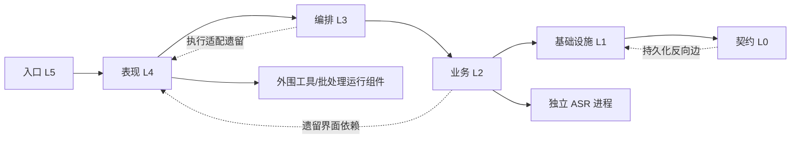

# R3405 结果 — A1 六层与工具体系实际依赖图诊断
<!-- round-evidence: {"commit_base": "d702e6dc", "credential_hits": 0, "evidence_sha256": "7b9eb9e3d45ae063", "exit": 0, "failed": 0, "passed": 0, "round": 3405, "tests": "docs-only"} -->

## 三问

1. 类型：§3.5 只读诊断；仅新增本报告及标准提交生成的轮次证据，不改生产代码/规则。
2. 验证：见 M；只读诊断不机械重复 A0 全架构或全量。旧 9/9、532 条结果不是本树现时绿色证明。
3. 欠账：未修复生产欠账；将扫描覆盖、异常边与工具运行关系转为定位清单。A1 完成不等于整体完成。

## A. 基线与范围
日期：2026-11-18；当前分支 `codex/architecture-a1-audit`；开工继承 A0 `6b135734`，原为 detached HEAD，建立独立分支后已 rebase master。诊断 HEAD `d702e6dc04b2c7ebe5e0fc1c672b5b53c4e35e0a`；master `3a97b184cedc1fffeea2ac148e9507e4341fe429`；二者生产源码相同（差异仅 A0/任务书文档）。R3403 已合入 K2，故 script_contract→script_skill_report 动态边不再存在。领号 R3405，领号进程有 GBK reader 警告但返回轮次，归属在提交前复核。
权威：architecture §3、_layers、_scan、层级台账、动态登记及分发清单。方法：调用现有扫描器读取 AST；逐 import 记录物理路径/行号/最内层函数；Tarjan 求强连通分量；补查包导入、相对导入、重复 stem、工具消费者和进程入口。AST 边包括函数内懒导入，不等同启动时执行或运行时死锁；没有启动 UI、模型、付费调用或 ASR 下载。

## B. 车道与文件冲突
| 车道 | master 左落后/右独有提交 | 处置 |
|---|---|---|
| codex/l0-constitution | 0	0 | 只读；不代做源码/规则 |
| codex/l1-enterprise | 3	2 | 只读；不代做源码/规则 |
| codex/l2-maturity-taskbook | 3	2 | 只读；不代做源码/规则 |
| codex/foundation-hardening | 16	19 | 只读；不代做源码/规则 |
| codex/foundation-api-disk | 45	17 | 只读；不代做源码/规则 |
`dev.py scope 程序/tasks_round/tasks_round_3405_result.md`：另 87 个活跃分支无重叠。lanes.json 已只读检查；车道名称相同/last_seen 不证明已停止。L0 当前与 master 一致不代表未来所有权释放；L1/L2/foundation 在途规则仍不得修改。

## C. 实测覆盖与层级图
层级扫描 431 个物理文件；425 个扁平节点；运行时递归口径 662 个文件；登记名 411；显式工具 5。包内未登记 16 个。运行时与层级扫描差集去掉可识别门面后 12 文件，逐项如下。数字按当前文件系统实测，不沿用任务书旧数。
| 未进入层级图的路径 | 性质/处置 |
|---|---|
| agent/__init__.py | 包初始化；本次 AST 检查，后续纳入初始化副作用审计 |
| batch_frames_tool/batch_frames.py | 独立批处理工具，但有生产消费者，不能直接视为开发专用 |
| contract/__init__.py | 包初始化；本次 AST 检查，后续纳入初始化副作用审计 |
| domain/__init__.py | 包初始化；本次 AST 检查，后续纳入初始化副作用审计 |
| infra/__init__.py | 包初始化；本次 AST 检查，后续纳入初始化副作用审计 |
| orchestrator/__init__.py | 包初始化；本次 AST 检查，后续纳入初始化副作用审计 |
| ui/__init__.py | 包初始化；本次 AST 检查，后续纳入初始化副作用审计 |
| voice_engine/__init__.py | 独立 ASR 进程/安装支持，需单列协议与依赖守卫 |
| voice_engine/bootstrap.py | 独立 ASR 进程/安装支持，需单列协议与依赖守卫 |
| voice_engine/download_models.py | 独立 ASR 进程/安装支持，需单列协议与依赖守卫 |
| voice_engine/funasr_config.py | 独立 ASR 进程/安装支持，需单列协议与依赖守卫 |
| voice_engine/offline_asr_server.py | 独立 ASR 进程/安装支持，需单列协议与依赖守卫 |
尚未登记但已入扫描：`domain/checkpoint_tree.py`, `domain/hitl.py`, `ui/edit_habits_dialog.py`, `ui/project_settings_dialog.py`, `ui/ui_asset_card.py`, `ui/ui_branch_tree.py`, `ui/ui_citation.py`, `ui/ui_code_block.py`, `ui/ui_diff.py`, `ui/ui_hitl.py`, `ui/ui_media.py`, `ui/ui_media_player.py`, `ui/ui_multimodal.py`, `ui/ui_param_panel.py`, `ui/ui_part_renderers.py`, `ui/ui_task_progress.py`。当前顶层完整性测试不覆盖这些包内未登记实体；其边不能通过 LAYERS.get 判断方向。
| 调用层→目标层 | AST 导入位置数（非去重边） |
|---|---|
| L0 → L0 | 39 |
| L0 → L1 | 10 |
| L1 → L0 | 76 |
| L1 → L1 | 147 |
| L1 → L2 | 1 |
| L1 → L3 | 1 |
| L1 → L4 | 1 |
| L2 → L0 | 200 |
| L2 → L1 | 141 |
| L2 → L2 | 68 |
| L2 → L3 | 2 |
| L2 → L4 | 6 |
| L3 → L0 | 193 |
| L3 → L1 | 299 |
| L3 → L2 | 224 |
| L3 → L3 | 214 |
| L3 → L4 | 2 |
| L4 → L0 | 164 |
| L4 → L1 | 397 |
| L4 → L2 | 193 |
| L4 → L3 | 370 |
| L4 → L4 | 473 |
| L5 → L0 | 2 |
| L5 → L1 | 8 |
| L5 → L4 | 2 |

## D. 静态与常量动态反向边（逐位置）
共 25 个导入位置；静态 23、动态 2；模块对去重 20。位置数与棘轮模块对数不能混用。
| 类型 | 调用方 | 被调用方 | 场景/函数 | 位置 | 豁免 | 替代方案 |
|---|---|---|---|---|---|---|
| 静态 | api_models L0 | core L1 | cloud_removed | contract/api_models.py:62 | 层级台账既存豁免 | 由上层注入持久化/发布能力；纯契约不依赖 agent.core |
| 静态 | artifact_lineage L0 | core L1 | 模块装载 | contract/artifact_lineage.py:14 | 层级台账既存豁免 | 由上层注入持久化/发布能力；纯契约不依赖 agent.core |
| 静态 | pet_bus L0 | core L1 | 模块装载 | contract/pet_bus.py:14 | 层级台账既存豁免 | 由上层注入持久化/发布能力；纯契约不依赖 agent.core |
| 静态 | script_contract L0 | core L1 | 模块装载 | contract/script_contract.py:36 | 层级台账既存豁免 | 由上层注入持久化/发布能力；纯契约不依赖 agent.core |
| 静态 | script_contract L0 | core L1 | save_natural_script | contract/script_contract.py:69 | 层级台账既存豁免 | 由上层注入持久化/发布能力；纯契约不依赖 agent.core |
| 静态 | script_contract L0 | core L1 | write_episode_ledger | contract/script_contract.py:250 | 层级台账既存豁免 | 由上层注入持久化/发布能力；纯契约不依赖 agent.core |
| 静态 | script_contract L0 | core L1 | write_structure_manifests | contract/script_contract.py:908 | 层级台账既存豁免 | 由上层注入持久化/发布能力；纯契约不依赖 agent.core |
| 静态 | script_contract L0 | core L1 | write_structured_script | contract/script_contract.py:834 | 层级台账既存豁免 | 由上层注入持久化/发布能力；纯契约不依赖 agent.core |
| 静态 | script_manifest_schema L0 | core L1 | 模块装载 | contract/script_manifest_schema.py:17 | 层级台账既存豁免 | 由上层注入持久化/发布能力；纯契约不依赖 agent.core |
| 静态 | stage_layout L0 | core L1 | 模块装载 | contract/stage_layout.py:30 | 层级台账既存豁免 | 由上层注入持久化/发布能力；纯契约不依赖 agent.core |
| 静态 | engine_probe L1 | workflow_engines L3 | app_argv | infra/engine_probe.py:93 | 层级台账既存豁免 | 提取无 UI 业务能力或由 L3/L5 注入适配回调；保留兼容入口 |
| 静态 | h3_reference_adapter L1 | shot_assets L2 | 模块装载 | infra/h3_reference_adapter.py:2 | 层级台账既存豁免 | 提取无 UI 业务能力或由 L3/L5 注入适配回调；保留兼容入口 |
| 静态 | native_apps L1 | white_model L4 | open_blender | infra/native_apps.py:91 | 层级台账既存豁免 | 提取无 UI 业务能力或由 L3/L5 注入适配回调；保留兼容入口 |
| 静态 | asset_batch_service L2 | asset_reference_images L4 | asset_prompt | domain/asset_batch_service.py:43 | 层级台账既存豁免 | 提取无 UI 业务能力或由 L3/L5 注入适配回调；保留兼容入口 |
| 静态 | asset_batch_service L2 | asset_reference_images L4 | register_image | domain/asset_batch_service.py:77 | 层级台账既存豁免 | 提取无 UI 业务能力或由 L3/L5 注入适配回调；保留兼容入口 |
| 静态 | confirm_gates L2 | legacy_compat L3 | 模块装载 | domain/confirm_gates.py:27 | 层级台账既存豁免 | 把身份/兼容纯规则收至允许的低层契约，迁移消费者 |
| 静态 | idea_chat L2 | pet_agent L4 | reply_text | domain/idea_chat.py:811 | 层级台账既存豁免 | 提取无 UI 业务能力或由 L3/L5 注入适配回调；保留兼容入口 |
| 静态 | idea_document_paths L2 | legacy_compat L3 | storage_identity | domain/idea_document_paths.py:41 | 层级台账既存豁免 | 把身份/兼容纯规则收至允许的低层契约，迁移消费者 |
| 静态 | asset_batch_execution L3 | asset_reference_images L4 | run_batch | orchestrator/asset_batch_execution.py:108 | 层级台账既存豁免 | 提取无 UI 业务能力或由 L3/L5 注入适配回调；保留兼容入口 |
| 静态 | skill_orchestrator L3 | skill_tools L4 | 模块装载 | orchestrator/skill_orchestrator.py:28 | 层级台账既存豁免 | 提取无 UI 业务能力或由 L3/L5 注入适配回调；保留兼容入口 |
| 静态 | shot_assets L2 | white_model_ref L4 | prepare | agent/shot_assets.py:118 | 层级台账既存豁免 | 提取无 UI 业务能力或由 L3/L5 注入适配回调；保留兼容入口 |
| 静态 | volcengine L2 | white_model_ref L4 | payload | agent/volcengine.py:23 | 层级台账既存豁免 | 提取无 UI 业务能力或由 L3/L5 注入适配回调；保留兼容入口 |
| 静态 | wan L2 | white_model_ref L4 | payload | agent/wan.py:19 | 层级台账既存豁免 | 提取无 UI 业务能力或由 L3/L5 注入适配回调；保留兼容入口 |
| 动态 | keyframe_batch L2 | stage_parallel L3 | _brief_block | domain/keyframe_batch.py:276 | 动态层级台账既存豁免 | 由编排层计算简报阻断状态并注入业务服务 |
| 动态 | engine L3 | white_model L4 | submit | orchestrator/engine.py:444 | 动态层级台账既存豁免 | 提取无 UI 业务能力或由 L3/L5 注入适配回调；保留兼容入口 |

## E. 同层及跨层环

### core → file_cache → publication
同层强连通分量；箭头列表只表示成员，不表示这个排列是调用顺序。现有豁免见 test_no_circular_import.KNOWN_STATIC_CYCLES/KNOWN_DYNAMIC_CYCLES。替代：共享底层能力单向依赖或使用上层注入；不要仅把 import 移到函数体。
| 调用方 | 被调用方 | 场景 | 位置 | 类型 |
|---|---|---|---|---|
| file_cache | core | 模块装载 | infra/file_cache.py:15 | 静态 |
| file_cache | publication | 模块装载 | infra/file_cache.py:16 | 静态 |
| core | publication | read | agent/core.py:13 | 静态 |
| core | publication | replace | agent/core.py:36 | 静态 |
| core | file_cache | rename_with_references | agent/core.py:68 | 静态 |
| core | file_cache | restore_bytes | agent/core.py:183 | 静态 |
| core | file_cache | save_bytes_new | agent/core.py:200 | 静态 |
| core | file_cache | copy_file_new | agent/core.py:236 | 静态 |
| core | file_cache | _replace_locked | agent/core.py:56 | 静态 |
| publication | file_cache | _discard | agent/publication.py:66 | 静态 |
| publication | file_cache | _recover | agent/publication.py:104 | 静态 |

### keyframe_evidence → shot_assets → stage_parallel → white_model → white_model_ref
跨层强连通分量；箭头列表只表示成员，不表示这个排列是调用顺序。现有豁免见 test_no_circular_import.KNOWN_STATIC_CYCLES/KNOWN_DYNAMIC_CYCLES。替代：共享底层能力单向依赖或使用上层注入；不要仅把 import 移到函数体。
| 调用方 | 被调用方 | 场景 | 位置 | 类型 |
|---|---|---|---|---|
| keyframe_evidence | shot_assets | source_evidence | domain/keyframe_evidence.py:101 | 静态 |
| stage_parallel | keyframe_evidence | frames_ready | orchestrator/stage_parallel.py:834 | 静态 |
| white_model | white_model_ref | validate_video_submission | ui/white_model.py:190 | 动态 |
| white_model | stage_parallel | _brief_block | ui/white_model.py:29 | 动态 |
| white_model_ref | white_model | shot_folder | ui/white_model_ref.py:79 | 静态 |
| shot_assets | white_model_ref | prepare | agent/shot_assets.py:118 | 静态 |

### stage_models → workflow_settings
同层强连通分量；箭头列表只表示成员，不表示这个排列是调用顺序。现有豁免见 test_no_circular_import.KNOWN_STATIC_CYCLES/KNOWN_DYNAMIC_CYCLES。替代：共享底层能力单向依赖或使用上层注入；不要仅把 import 移到函数体。
| 调用方 | 被调用方 | 场景 | 位置 | 类型 |
|---|---|---|---|---|
| stage_models | workflow_settings | keyframe_choices | orchestrator/stage_models.py:57 | 动态 |
| workflow_settings | stage_models | stage_model | orchestrator/workflow_settings.py:283 | 静态 |

### local_video → skill_orchestrator → skill_tools → stage_execution_service
跨层强连通分量；箭头列表只表示成员，不表示这个排列是调用顺序。现有豁免见 test_no_circular_import.KNOWN_STATIC_CYCLES/KNOWN_DYNAMIC_CYCLES。替代：共享底层能力单向依赖或使用上层注入；不要仅把 import 移到函数体。
| 调用方 | 被调用方 | 场景 | 位置 | 类型 |
|---|---|---|---|---|
| local_video | stage_execution_service | commit | local_video.py:400 | 动态 |
| stage_execution_service | skill_orchestrator | build_orchestrator | stage_execution_service.py:697 | 静态 |
| skill_orchestrator | skill_tools | 模块装载 | orchestrator/skill_orchestrator.py:28 | 静态 |
| skill_tools | local_video | _video_poll | ui/skill_tools.py:380 | 静态 |
| skill_tools | local_video | _edit_compose | ui/skill_tools.py:398 | 静态 |

### 补充：包限定 AST 图检出的遗漏同层环

以完整点分路径为节点，从所有运行时文件解析 import/from-import（相对 import 结合当前包还原）；from 包 import 名称仅当该完整子模块文件存在才解析成模块，否则保留包目标。该静态图得到 2 个非平凡 SCC：已知 agent.core/agent.publication/infra.file_cache，以及新暴露的 L1 api_endpoints/diagnostic_capture/model_metering/model_pool/request_ledger。后者不是新增代码缺陷，而是子模块导入漏识别造成的既存门禁盲区；函数内导入形成结构环不等于启动崩溃。以下列其全部内部静态边：

| 调用方 | 被调用方 | 场景 | 位置 | 豁免 | 替代方案 |
|---|---|---|---|---|---|
| api_endpoints L1 | model_metering L1 | 模块装载 | infra/api_endpoints.py:9 | 不在现有环豁免集合 | 将诊断上报作为注入端口，避免模型计量与诊断互导；需保持计量行为 |
| diagnostic_capture L1 | request_ledger L1 | _check_request_ledger | infra/diagnostic_capture.py:473 | 不在现有环豁免集合 | 将诊断上报作为注入端口，避免模型计量与诊断互导；需保持计量行为 |
| diagnostic_capture L1 | request_ledger L1 | _check_ledger_unknown_stale | infra/diagnostic_capture.py:504 | 不在现有环豁免集合 | 将诊断上报作为注入端口，避免模型计量与诊断互导；需保持计量行为 |
| diagnostic_capture L1 | model_pool L1 | _check_model_pool | infra/diagnostic_capture.py:294 | 不在现有环豁免集合 | 将诊断上报作为注入端口，避免模型计量与诊断互导；需保持计量行为 |
| model_metering L1 | request_ledger L1 | _record_attempt | infra/model_metering.py:31 | 不在现有环豁免集合 | 将诊断上报作为注入端口，避免模型计量与诊断互导；需保持计量行为 |
| model_metering L1 | diagnostic_capture L1 | _settle | infra/model_metering.py:20 | 不在现有环豁免集合 | 将诊断上报作为注入端口，避免模型计量与诊断互导；需保持计量行为 |
| model_pool L1 | model_metering L1 | 模块装载 | infra/model_pool.py:22 | 不在现有环豁免集合 | 将诊断上报作为注入端口，避免模型计量与诊断互导；需保持计量行为 |
| model_pool L1 | api_endpoints L1 | 模块装载 | infra/model_pool.py:24 | 不在现有环豁免集合 | 将诊断上报作为注入端口，避免模型计量与诊断互导；需保持计量行为 |
| model_pool L1 | api_endpoints L1 | _http_transport | infra/model_pool.py:958 | 不在现有环豁免集合 | 将诊断上报作为注入端口，避免模型计量与诊断互导；需保持计量行为 |
| model_pool L1 | api_endpoints L1 | http_stream | infra/model_pool.py:964 | 不在现有环豁免集合 | 将诊断上报作为注入端口，避免模型计量与诊断互导；需保持计量行为 |
| request_ledger L1 | diagnostic_capture L1 | _settle_lock_timeout | infra/request_ledger.py:146 | 不在现有环豁免集合 | 将诊断上报作为注入端口，避免模型计量与诊断互导；需保持计量行为 |

## F. 别名与扫描失真
| 扁平键冲突 | 物理文件 |
|---|---|
| file_index | file_index.py, infra/file_index.py |
| file_index_contract | file_index_contract.py, contract/file_index_contract.py |
| file_naming | file_naming.py, contract/file_naming.py |
| global_library_service | global_library_service.py, domain/global_library_service.py |
| legacy_migration | legacy_migration.py, orchestrator/legacy_migration.py |
| storage_maintenance | storage_maintenance.py, infra/storage_maintenance.py |
环扫描用 dict 的 stem 键，后读包实体覆盖前面的同名门面；不是六组生产实现重复的证明。`storage_maintenance.py:14` 带复合 __main__ 条件，门面识别只认简单 Compare，故仍入图。改扫描器必须保留包限定身份并明确兼容别名映射。
补查 58 条当前扫描漏掉的子模块目标（逐位置）。其中已登记两端没有新增反向边；未知层不能判合格。相对导入需结合包路径解释，不能用字符串后缀代替。
| 调用方 | 实际子模块 | 场景 | 位置 | 现状 | 替代 |
|---|---|---|---|---|---|
| desktop_shared_input | pet_bus | 模块装载 | desktop_shared_input.py:25 | 未按模块目标识别；非越层豁免 | 解析 from 包 import 子模块及相对导入 |
| desktop_shared_send | pet_bus | 模块装载 | desktop_shared_send.py:14 | 未按模块目标识别；非越层豁免 | 解析 from 包 import 子模块及相对导入 |
| pet_agent | error_codes | 模块装载 | pet_agent.py:26 | 未按模块目标识别；非越层豁免 | 解析 from 包 import 子模块及相对导入 |
| pet_skills_manage | platform_tools | 模块装载 | pet_skills_manage.py:25 | 未按模块目标识别；非越层豁免 | 解析 from 包 import 子模块及相对导入 |
| pet_skills_manage | agent_skill_sync | run | pet_skills_manage.py:435 | 未按模块目标识别；非越层豁免 | 解析 from 包 import 子模块及相对导入 |
| storage_maintenance | storage_maintenance | 模块装载 | storage_maintenance.py:9 | 未按模块目标识别；非越层豁免 | 解析 from 包 import 子模块及相对导入 |
| project_stages | stage_layout | stage_dirs | contract/project_stages.py:14 | 未按模块目标识别；非越层豁免 | 解析 from 包 import 子模块及相对导入 |
| selfcheck | stage_layout | _stage_contract_check | contract/selfcheck.py:85 | 未按模块目标识别；非越层豁免 | 解析 from 包 import 子模块及相对导入 |
| selfcheck | artifact_schema | _artifact_registry_check | contract/selfcheck.py:94 | 未按模块目标识别；非越层豁免 | 解析 from 包 import 子模块及相对导入 |
| diagnostic_capture | platform_tools | _check_bundled_tools | infra/diagnostic_capture.py:312 | 未按模块目标识别；非越层豁免 | 解析 from 包 import 子模块及相对导入 |
| diagnostic_capture | selfcheck | run_startup_selfcheck | infra/diagnostic_capture.py:696 | 未按模块目标识别；非越层豁免 | 解析 from 包 import 子模块及相对导入 |
| file_index | file_naming | 模块装载 | infra/file_index.py:24 | 未按模块目标识别；非越层豁免 | 解析 from 包 import 子模块及相对导入 |
| model_metering | diagnostic_capture | _settle | infra/model_metering.py:20 | 未按模块目标识别；非越层豁免 | 解析 from 包 import 子模块及相对导入 |
| model_router | error_codes | error_class | infra/model_router.py:193 | 未按模块目标识别；非越层豁免 | 解析 from 包 import 子模块及相对导入 |
| native_apps | workflow_process_registry | force_close_comfy | infra/native_apps.py:50 | 未按模块目标识别；非越层豁免 | 解析 from 包 import 子模块及相对导入 |
| request_ledger | diagnostic_capture | _settle_lock_timeout | infra/request_ledger.py:146 | 未按模块目标识别；非越层豁免 | 解析 from 包 import 子模块及相对导入 |
| seedream_api | model_secrets | protect | infra/seedream_api.py:61 | 未按模块目标识别；非越层豁免 | 解析 from 包 import 子模块及相对导入 |
| temporary_sweep | diagnostic_capture | work | infra/temporary_sweep.py:70 | 未按模块目标识别；非越层豁免 | 解析 from 包 import 子模块及相对导入 |
| asset_batch_service | unit_of_work | 模块装载 | domain/asset_batch_service.py:10 | 未按模块目标识别；非越层豁免 | 解析 from 包 import 子模块及相对导入 |
| asset_detail_service | unit_of_work | 模块装载 | domain/asset_detail_service.py:14 | 未按模块目标识别；非越层豁免 | 解析 from 包 import 子模块及相对导入 |
| global_library_service | file_index | 模块装载 | domain/global_library_service.py:18 | 未按模块目标识别；非越层豁免 | 解析 from 包 import 子模块及相对导入 |
| global_library_service | unit_of_work | 模块装载 | domain/global_library_service.py:18 | 未按模块目标识别；非越层豁免 | 解析 from 包 import 子模块及相对导入 |
| idea_chat | unit_of_work | 模块装载 | domain/idea_chat.py:20 | 未按模块目标识别；非越层豁免 | 解析 from 包 import 子模块及相对导入 |
| idea_transcript | message_parts | 模块装载 | domain/idea_transcript.py:25 | 未按模块目标识别；非越层豁免 | 解析 from 包 import 子模块及相对导入 |
| keyframe_lifecycle_service | domain_events | replace_keyframe | domain/keyframe_lifecycle_service.py:147 | 未按模块目标识别；非越层豁免 | 解析 from 包 import 子模块及相对导入 |
| local_video_settings_service | unit_of_work | 模块装载 | domain/local_video_settings_service.py:6 | 未按模块目标识别；非越层豁免 | 解析 from 包 import 子模块及相对导入 |
| projects | unit_of_work | 模块装载 | domain/projects.py:12 | 未按模块目标识别；非越层豁免 | 解析 from 包 import 子模块及相对导入 |
| recon_service | core | 模块装载 | domain/recon_service.py:31 | 未按模块目标识别；非越层豁免 | 解析 from 包 import 子模块及相对导入 |
| script_workspace_service | file_index | _update_index_after_rename | domain/script_workspace_service.py:537 | 未按模块目标识别；非越层豁免 | 解析 from 包 import 子模块及相对导入 |
| skill_command | pet_bus | 模块装载 | domain/skill_command.py:13 | 未按模块目标识别；非越层豁免 | 解析 from 包 import 子模块及相对导入 |
| video_prompt_publication | unit_of_work | 模块装载 | domain/video_prompt_publication.py:13 | 未按模块目标识别；非越层豁免 | 解析 from 包 import 子模块及相对导入 |
| white_model_service | unit_of_work | 模块装载 | domain/white_model_service.py:16 | 未按模块目标识别；非越层豁免 | 解析 from 包 import 子模块及相对导入 |
| stage_publication | file_index | _update_file_index | orchestrator/stage_publication.py:36 | 未按模块目标识别；非越层豁免 | 解析 from 包 import 子模块及相对导入 |
| asset_thumbs | file_index | media_kind | ui/asset_thumbs.py:188 | 未按模块目标识别；非越层豁免 | 解析 from 包 import 子模块及相对导入 |
| desktop_files_panel | file_index | _reload_current_view | ui/desktop_files_panel.py:211 | 未按模块目标识别；非越层豁免 | 解析 from 包 import 子模块及相对导入 |
| desktop_files_panel | file_index | open_script_file | ui/desktop_files_panel.py:407 | 未按模块目标识别；非越层豁免 | 解析 from 包 import 子模块及相对导入 |
| desktop_files_panel_filters | global_library_service | reference_from_library | ui/desktop_files_panel_filters.py:177 | 未按模块目标识别；非越层豁免 | 解析 from 包 import 子模块及相对导入 |
| desktop_files_panel_filters | file_index | reference_from_library | ui/desktop_files_panel_filters.py:178 | 未按模块目标识别；非越层豁免 | 解析 from 包 import 子模块及相对导入 |
| desktop_files_panel_filters | file_index | configure_library | ui/desktop_files_panel_filters.py:198 | 未按模块目标识别；非越层豁免 | 解析 from 包 import 子模块及相对导入 |
| desktop_files_panel_filters | global_library_service | add_to_library | ui/desktop_files_panel_filters.py:210 | 未按模块目标识别；非越层豁免 | 解析 from 包 import 子模块及相对导入 |
| desktop_files_panel_filters | file_index | add_to_library | ui/desktop_files_panel_filters.py:211 | 未按模块目标识别；非越层豁免 | 解析 from 包 import 子模块及相对导入 |
| desktop_files_panel_filters | file_index | show_library | ui/desktop_files_panel_filters.py:229 | 未按模块目标识别；非越层豁免 | 解析 from 包 import 子模块及相对导入 |
| desktop_files_panel_filters | file_index | _row_preview | ui/desktop_files_panel_filters.py:278 | 未按模块目标识别；非越层豁免 | 解析 from 包 import 子模块及相对导入 |
| desktop_files_panel_index | file_index | load_index | ui/desktop_files_panel_index.py:38 | 未按模块目标识别；非越层豁免 | 解析 from 包 import 子模块及相对导入 |
| desktop_files_panel_index | file_index | delete_index_files | ui/desktop_files_panel_index.py:316 | 未按模块目标识别；非越层豁免 | 解析 from 包 import 子模块及相对导入 |
| desktop_idea_bubbles | message_parts | add_bubble | ui/desktop_idea_bubbles.py:351 | 未按模块目标识别；非越层豁免 | 解析 from 包 import 子模块及相对导入 |
| desktop_idea_bubbles | ui_part_renderers | add_bubble | ui/desktop_idea_bubbles.py:352 | 未按模块目标识别；非越层豁免 | 解析 from 包 import 子模块及相对导入 |
| desktop_idea_chat | agent_skill_sync | prepare | ui/desktop_idea_chat.py:774 | 未按模块目标识别；非越层豁免 | 解析 from 包 import 子模块及相对导入 |
| keyframe_import | file_index | register | ui/keyframe_import.py:86 | 未按模块目标识别；非越层豁免 | 解析 from 包 import 子模块及相对导入 |
| keyframe_import | stage_layout | register | ui/keyframe_import.py:87 | 未按模块目标识别；非越层豁免 | 解析 from 包 import 子模块及相对导入 |
| skill_import_service | platform_tools | 模块装载 | ui/skill_import_service.py:44 | 未按模块目标识别；非越层豁免 | 解析 from 包 import 子模块及相对导入 |
| skill_remote_service | platform_tools | 模块装载 | ui/skill_remote_service.py:32 | 未按模块目标识别；非越层豁免 | 解析 from 包 import 子模块及相对导入 |
| skill_tools | media | _media_check | ui/skill_tools.py:323 | 未按模块目标识别；非越层豁免 | 解析 from 包 import 子模块及相对导入 |
| speech_settings_ui | offline_asr_setup | _offline_package_row | ui/speech_settings_ui.py:35 | 未按模块目标识别；非越层豁免 | 解析 from 包 import 子模块及相对导入 |
| ui_hitl | hitl | 模块装载 | ui/ui_hitl.py:12 | 未按模块目标识别；非越层豁免 | 解析 from 包 import 子模块及相对导入 |
| ui_multimodal | message_parts | 模块装载 | ui/ui_multimodal.py:9 | 未按模块目标识别；非越层豁免 | 解析 from 包 import 子模块及相对导入 |
| ui_part_renderers | message_parts | 模块装载 | ui/ui_part_renderers.py:20 | 未按模块目标识别；非越层豁免 | 解析 from 包 import 子模块及相对导入 |
| core | publication | rename_with_references | agent/core.py:67 | 未按模块目标识别；非越层豁免 | 解析 from 包 import 子模块及相对导入 |

## G. 动态注册与装配
唯一变量动态 import 为 `infra/ui_plugin_registry.py:24 import_module(text)`；先检查 UI_PLUGINS。现有常量扫描无法展开它。以下是注册目标，不伪称所有目标已在启动时运行；L1 注册器提供延迟加载机制，调用选择来自上层，属于需明确建模的装配例外。
| 调用方/场景 | 被调用注册目标 | 目标层 | 位置/豁免 | 替代方案 |
|---|---|---|---|---|
| ui_plugin_registry.module / 白名单延迟加载 | agent.prompt_optimizer | 4 | infra/ui_plugin_registry.py:9–24；规则18允许入口，无逐边层级台账 | 装配图单列注册器→目标与消费者→注册项，不把 L1 机制直接当业务依赖 |
| ui_plugin_registry.module / 白名单延迟加载 | agent.shot_assets | 2 | infra/ui_plugin_registry.py:9–24；规则18允许入口，无逐边层级台账 | 装配图单列注册器→目标与消费者→注册项，不把 L1 机制直接当业务依赖 |
| ui_plugin_registry.module / 白名单延迟加载 | agent_dispatch | 3 | infra/ui_plugin_registry.py:9–24；规则18允许入口，无逐边层级台账 | 装配图单列注册器→目标与消费者→注册项，不把 L1 机制直接当业务依赖 |
| ui_plugin_registry.module / 白名单延迟加载 | asset_batch | 4 | infra/ui_plugin_registry.py:9–24；规则18允许入口，无逐边层级台账 | 装配图单列注册器→目标与消费者→注册项，不把 L1 机制直接当业务依赖 |
| ui_plugin_registry.module / 白名单延迟加载 | asset_prompt_check_dialog | 4 | infra/ui_plugin_registry.py:9–24；规则18允许入口，无逐边层级台账 | 装配图单列注册器→目标与消费者→注册项，不把 L1 机制直接当业务依赖 |
| ui_plugin_registry.module / 白名单延迟加载 | asset_reference_images | 4 | infra/ui_plugin_registry.py:9–24；规则18允许入口，无逐边层级台账 | 装配图单列注册器→目标与消费者→注册项，不把 L1 机制直接当业务依赖 |
| ui_plugin_registry.module / 白名单延迟加载 | asset_reference_import | 4 | infra/ui_plugin_registry.py:9–24；规则18允许入口，无逐边层级台账 | 装配图单列注册器→目标与消费者→注册项，不把 L1 机制直接当业务依赖 |
| ui_plugin_registry.module / 白名单延迟加载 | asset_skill_batch | 4 | infra/ui_plugin_registry.py:9–24；规则18允许入口，无逐边层级台账 | 装配图单列注册器→目标与消费者→注册项，不把 L1 机制直接当业务依赖 |
| ui_plugin_registry.module / 白名单延迟加载 | background_characters | 4 | infra/ui_plugin_registry.py:9–24；规则18允许入口，无逐边层级台账 | 装配图单列注册器→目标与消费者→注册项，不把 L1 机制直接当业务依赖 |
| ui_plugin_registry.module / 白名单延迟加载 | cloud_video | 4 | infra/ui_plugin_registry.py:9–24；规则18允许入口，无逐边层级台账 | 装配图单列注册器→目标与消费者→注册项，不把 L1 机制直接当业务依赖 |
| ui_plugin_registry.module / 白名单延迟加载 | desktop_launcher | 5 | infra/ui_plugin_registry.py:9–24；规则18允许入口，无逐边层级台账 | 装配图单列注册器→目标与消费者→注册项，不把 L1 机制直接当业务依赖 |
| ui_plugin_registry.module / 白名单延迟加载 | desktop_voice_input | 4 | infra/ui_plugin_registry.py:9–24；规则18允许入口，无逐边层级台账 | 装配图单列注册器→目标与消费者→注册项，不把 L1 机制直接当业务依赖 |
| ui_plugin_registry.module / 白名单延迟加载 | keyframe_comfy | 4 | infra/ui_plugin_registry.py:9–24；规则18允许入口，无逐边层级台账 | 装配图单列注册器→目标与消费者→注册项，不把 L1 机制直接当业务依赖 |
| ui_plugin_registry.module / 白名单延迟加载 | local_previs | 4 | infra/ui_plugin_registry.py:9–24；规则18允许入口，无逐边层级台账 | 装配图单列注册器→目标与消费者→注册项，不把 L1 机制直接当业务依赖 |
| ui_plugin_registry.module / 白名单延迟加载 | native_assets | 4 | infra/ui_plugin_registry.py:9–24；规则18允许入口，无逐边层级台账 | 装配图单列注册器→目标与消费者→注册项，不把 L1 机制直接当业务依赖 |
| ui_plugin_registry.module / 白名单延迟加载 | pet_ui | 4 | infra/ui_plugin_registry.py:9–24；规则18允许入口，无逐边层级台账 | 装配图单列注册器→目标与消费者→注册项，不把 L1 机制直接当业务依赖 |
| ui_plugin_registry.module / 白名单延迟加载 | previs_automation | 3 | infra/ui_plugin_registry.py:9–24；规则18允许入口，无逐边层级台账 | 装配图单列注册器→目标与消费者→注册项，不把 L1 机制直接当业务依赖 |
| ui_plugin_registry.module / 白名单延迟加载 | reference_wall | 4 | infra/ui_plugin_registry.py:9–24；规则18允许入口，无逐边层级台账 | 装配图单列注册器→目标与消费者→注册项，不把 L1 机制直接当业务依赖 |
| ui_plugin_registry.module / 白名单延迟加载 | skill_panel | 4 | infra/ui_plugin_registry.py:9–24；规则18允许入口，无逐边层级台账 | 装配图单列注册器→目标与消费者→注册项，不把 L1 机制直接当业务依赖 |
| ui_plugin_registry.module / 白名单延迟加载 | stage_exec | 3 | infra/ui_plugin_registry.py:9–24；规则18允许入口，无逐边层级台账 | 装配图单列注册器→目标与消费者→注册项，不把 L1 机制直接当业务依赖 |
| ui_plugin_registry.module / 白名单延迟加载 | stage_flow | 3 | infra/ui_plugin_registry.py:9–24；规则18允许入口，无逐边层级台账 | 装配图单列注册器→目标与消费者→注册项，不把 L1 机制直接当业务依赖 |
| ui_plugin_registry.module / 白名单延迟加载 | task_center_ui | 4 | infra/ui_plugin_registry.py:9–24；规则18允许入口，无逐边层级台账 | 装配图单列注册器→目标与消费者→注册项，不把 L1 机制直接当业务依赖 |
| ui_plugin_registry.module / 白名单延迟加载 | workflow_settings | 3 | infra/ui_plugin_registry.py:9–24；规则18允许入口，无逐边层级台账 | 装配图单列注册器→目标与消费者→注册项，不把 L1 机制直接当业务依赖 |
`desktop.py:183` 装配 DesktopStartupController；`desktop.py:193` 装配后台调度器。`app.py:1487` 经注册器调用 desktop_launcher.launch；`desktop.py:972` 保留直接桌面入口。`orchestrator/stage_handler_registry.py` 接收 desktop 回调/账号闸门，静态 import 不表达这些 L3→UI 对象运行调用；A3/A6 需核验取消、状态及生命周期，不宣称本轮已运行验证。包初始化复核：agent 为空，contract/domain/infra/orchestrator/ui 仅文档字符串；voice_engine/__init__.py:11–16 修改 sys.path，须在独立进程边界验证。正式启动与调试入口有区别：desktop_launcher.py:22 默认 selfcheck=True，app.py:1487 显式 False，desktop.py:972 直接启动属于已说明的调试入口，不误报正式自检缺失。离线 ASR：`domain/offline_asr_client.py:26` 指向独立 server 脚本，跨进程 JSON-Lines 不是普通 import 边。

## H. 工具体系与生产反向依赖
| 调用方 | 被调用方 | 场景 | 位置 | 现有豁免 | 替代方案 |
|---|---|---|---|---|---|
| image_agent_runner | batch_frames_tool | _execute | image_agent_runner.py:96 | TOOLS 排除层级判定；非生产使用许可 | 按消费者重分类运行适配器，或上层注入；不可直接删除 |
| cloud_assets | batch_frames_tool | graph | infra/cloud_assets.py:70 | TOOLS 排除层级判定；非生产使用许可 | 按消费者重分类运行适配器，或上层注入；不可直接删除 |
| comfy_service | batch_frames_tool | reference_config | infra/comfy_service.py:133 | TOOLS 排除层级判定；非生产使用许可 | 按消费者重分类运行适配器，或上层注入；不可直接删除 |
| comfy_service | batch_frames_tool | reference_graph | infra/comfy_service.py:146 | TOOLS 排除层级判定；非生产使用许可 | 按消费者重分类运行适配器，或上层注入；不可直接删除 |
| agent_dispatch | codex_tasks | 模块装载 | orchestrator/agent_dispatch.py:6 | TOOLS 排除层级判定；非生产使用许可 | 按消费者重分类运行适配器，或上层注入；不可直接删除 |
| workflow_engines | console_submit | submit_existing | orchestrator/workflow_engines.py:563 | TOOLS 排除层级判定；非生产使用许可 | 按消费者重分类运行适配器，或上层注入；不可直接删除 |
| workflow_engines | codex_tasks | launch_interactive | orchestrator/workflow_engines.py:491 | TOOLS 排除层级判定；非生产使用许可 | 按消费者重分类运行适配器，或上层注入；不可直接删除 |
| workflow_engines | console_submit | close_for_restart | orchestrator/workflow_engines.py:546 | TOOLS 排除层级判定；非生产使用许可 | 按消费者重分类运行适配器，或上层注入；不可直接删除 |
| desktop_idea_chat | codex_tasks | build | ui/desktop_idea_chat.py:760 | TOOLS 排除层级判定；非生产使用许可 | 按消费者重分类运行适配器，或上层注入；不可直接删除 |
| desktop_idea_chat | codex_paste | done | ui/desktop_idea_chat.py:982 | TOOLS 排除层级判定；非生产使用许可 | 按消费者重分类运行适配器，或上层注入；不可直接删除 |
| desktop_idea_chat | codex_paste | done | ui/desktop_idea_chat.py:965 | TOOLS 排除层级判定；非生产使用许可 | 按消费者重分类运行适配器，或上层注入；不可直接删除 |
| desktop_pet_bridge | batch_frames_tool | batch_blockers | ui/desktop_pet_bridge.py:91 | TOOLS 排除层级判定；非生产使用许可 | 按消费者重分类运行适配器，或上层注入；不可直接删除 |
| desktop_send_choice | codex_paste | deliver_desktop_app | ui/desktop_send_choice.py:60 | TOOLS 排除层级判定；非生产使用许可 | 按消费者重分类运行适配器，或上层注入；不可直接删除 |
| desktop_send_choice | codex_tasks | prepare_native | ui/desktop_send_choice.py:104 | TOOLS 排除层级判定；非生产使用许可 | 按消费者重分类运行适配器，或上层注入；不可直接删除 |
| keyframe_comfy | batch_frames_tool | engine | ui/keyframe_comfy.py:37 | TOOLS 排除层级判定；非生产使用许可 | 按消费者重分类运行适配器，或上层注入；不可直接删除 |
| keyframe_comfy | batch_frames_tool | check_shot | ui/keyframe_comfy.py:105 | TOOLS 排除层级判定；非生产使用许可 | 按消费者重分类运行适配器，或上层注入；不可直接删除 |
| native_assets | batch_frames_tool | run | ui/native_assets.py:227 | TOOLS 排除层级判定；非生产使用许可 | 按消费者重分类运行适配器，或上层注入；不可直接删除 |
上述 17 处说明 TOOLS 的“不会被产品层导入”注释与实际导入不符；不等于所有调用都在冷启动执行。`batch_frames_tool/batch_frames.py` 是生产使用的批处理运行组件。scripts/dev.py、维护记录/基准脚本、tests 和自检执行器属开发工具；本次现有扫描未发现已登记生产模块直接 import scripts/tests/run_selftests，但此结论不覆盖任意文件路径执行、技能脚本和未知动态拼接。分发清单要求保留生产与 voice_engine，排除测试/开发脚本；发布验证应按真实依赖而非目录名字决定。

## I. 风险与未验证边界

优先级：P1 扫描完整性（未登记、漏子模块、stem 覆盖）；P1 工具运行分类与分发；P2 既存反向边和环迁移。已有层级门禁绿只能证明已建模的边未增长。AST 不证明函数被执行，包名不等于职责（例如 domain/global_library_service 登记 L1，ui_plugin_registry 位于 infra 却承载 UI 注册）。未做任意运行时反射跟踪、回调执行链、事件时序、文件写入和线程生命周期验证；这些交由 A3/A6，不把未验证写成无问题。

## J. 整改路线（本轮不执行）

J1：A4 与 L1/foundation 所有者协商扫描器迁移：包限定名、from-import、相对导入、初始化与未登记包完整性；先修图再冻结新基线。
J2：工具消费者移交 A5/A15，明确打包依赖与兼容责任，不按 TOOLS 标签删除。
J3：按 D/E 每条边分批（每轮最多3模块），优先 L0 发布能力依赖倒置；复用 L0/foundation 交付，避免重复实现。
J4：A3 核对 UI 注册/阶段回调/ASR 进程接线；A6 验证生命周期与异常路径。
J5：下一轮 A2 文档、规则与事实真源冲突诊断，继承本报告而不提前改规则。

## K. 测试迁移计划

先为扫描器构造小型临时包图夹具：from package import module、相对导入、重复 stem、带主入口门面、包内未登记实体、变量注册表；验证发现预设反向边/同层环而不是仅匹配源码。运行组件与开发工具要用实际构建副本 import/启动契约验收。迁移豁免前保持原消费者行为测试；发布与取消恢复用注入假实现覆盖失败路径。新增守卫及重算基线由后续授权执行轮承担。

## L. A1 验收与后续授权

[x] 扫描覆盖、别名、同层环、反向边、动态注册、装配入口及工具体系均有当次证据。
[x] 异常边逐项列调用方/被调用方/场景/位置/豁免/替代。
[x] 未扫描包、未登记实体与未验证运行行为明确列出。
本轮不勾改任务书，不生成全任务完成文件。A0/A1 只是阶段证据；目标仍是全部授权范围通过验收并合入 master。A1 标准提交后创建 A2 接续会话。

## M. 验证与提交

- 随附解释器 `D:/漫剧制作助手/运行环境/Python/python.exe`，在本工作树 `程序` 运行 `run_selftests.py -k test_layers test_no_circular_import`：2 文件、8 用例、0 红、0 skip；层级 6 条、环 2 条。验证通过不否定 F/E 的补充图发现。
- 默认冒烟：本轮未运行，A0 历史 9/9；完整架构：本轮未运行，A0 历史 532 条/2 failure+1 error，本轮已吸收 K2 不能当作同一受测树；改前后无生产变更，未声称完整架构转绿。
- 全量：本轮未运行。`auto_full_safe.py --status` 当前显示最后成功 R3293、最新 R3405、源码轮22、阈值8；本分支非 master 不触发后台。最近后台红 HEAD 00ff796，退出1，失败文件 test_shared_adapter_infrastructure/test_ui_edges_guards/test_pet_ui。此为新增观测，不覆盖 A0 的历史记录；最终主干验收需闭环。
- 一次 `run_selftests.py --help` 实际被旧执行器当作过滤词，执行0文件/0用例；不计入验证通过数。
- `project_status.md` 当前轮次3404，最新结果3405：N != M+1；按 master 专属写规则留给合入轮，不越权修改。
- 提交前检查 `git diff --check`、暂存清单、领号归属；仅本结果和标准自动证据。标准提交标题 `R3405: 完成A1六层与工具依赖诊断`，精确哈希以同标题 Git 记录为准（避免自引用哈希）。没有 push，也没有宣称合入 master。
