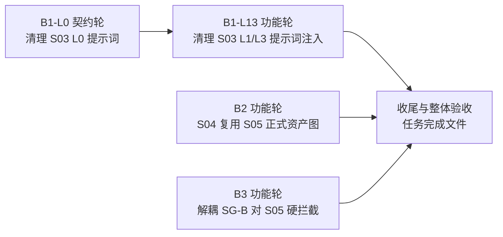

# 分镜预演与资产管理解耦及 S03 提示词清理任务书

> 编写日期：2026-11-27　｜　来源：用户需求分析与拍板（会话 `47d374dc`，方案 B + 清理历史冲突提示词 + 其余按推荐）
> 基线分支：`codex/wip-r4558`（`7cdc104d5`；执行各卡时以主干或指定车道最新基线为准，开工前实测行号）
> 复用要求（`程序/AGENTS.md` §2.5 规则 35、`程序/runbook.md` §16）：优先复用本仓库已有契约、网关与纯函数模块（各卡已明确落点），并评估 GitHub 成熟方案；本任务书全部改动为应用内阶段编排、提示词文本与本地资产路径解析，现有实现已完全覆盖，**零新增第三方依赖**（不引入额外工作流引擎或规则库，避免破坏白名单与分发体积）。
> 关联规格：`程序/docs/stages/S03_初步分镜.md`（`REQ/DES-S03-56`）、`程序/docs/stages/S04_分镜预演.md`（`REQ-S04-113` / `DES-S04-36`）、`程序/docs/stages/S05_资产管理.md`（`REQ/DES-S05-53`）、`程序/docs/records/对话需求追溯.md`。

---

## 0. 总目标

在不破坏 13 阶段固定顺序与历史项目目录兼容（ADR-0003）的前提下，解决创作者在「03 初步分镜 ↔ 04 分镜预演 ↔ 05 资产管理」三阶段间遇到的口径矛盾与体验割裂：

1. **清理 `03 初步分镜` 历史冲突提示词（`REQ-S03-56`）**：去除残留的旧 3 步流程文案（要求 S03 预先读取资产库、同步写 `assets.json`、复制 `character_anchor` 锚点），明确 S03 只认 S02 结构剧本，正式资产建档与锚点对齐归 S05／S07。
2. **打通 `04 分镜预演` 只读优先复用 `05 资产管理` 正式资产图（`REQ-S04-113`）**：当创作者先在 S05 入库了角色或场景正式资产图时，S04 自动按编号（`CHAR_###`／`LOC_###`）、名称与 `aliases` 优先匹配这些正式图，未命中再回退共享参考库与风格图，消除两套参考图割裂；同时严守 S04 对 S05 的只读边界。
3. **解耦 `SG-B` 对手动 `05 资产管理` 的硬拦截（`REQ-S05-53`）**：`stage_flow.DEPENDS['assets']` 回归真实数据依赖 `('storyboard',)`；`SG-B` 保留在 7 门禁连续链中并补齐「未开始不拦」与 `advisory=True` 提醒型语义，允许手动自由选择「先预演后资产」或「先资产后预演」；正式资产仍强制校验线上 API 模型，三虎全自动 `PRODUCTION` 门禁与 S04 锁定回写语义保持不变。

**明确不做**：
- 不对调 `pet_bus.STAGES` 中 `animatic`（04）与 `assets`（05）的序号与目录名，不触碰 ADR-0003 阶段顺序与 `LEGACY_NUMBERED` 历史目录映射。
- 不将 S05 资产清单来源扩展为从 S02 三份 manifest 预导入（仍严格遵循 `REQ-S05-01`，由 S03 已采用分镜派生）。
- 不削弱 `REQ-S04-26`／`REQ-S05-22` 的线上 API 模型校验，不放宽 S04 完成核验（`REQ-S04-41`）或锁定回写事务（`REQ-S04-90`）。
- 不新增弹窗（提醒一律走状态栏，遵守用户要求第 17 条）。

---

## 1. 已确认决策清单（执行者不得自行变更）

| 编号 | 决策 | 来源 |
|---|---|---|
| PB-D1 | 采用 **方案 B**：保留 13 阶段现有编号与目录契约，通过门禁提醒化与资产图复用打通 `04 ↔ 05` 双向体验 | 用户 2026-11-27 拍板「方案B」 |
| PB-D2 | 清理 `03 初步分镜` 历史冲突资产提示词，明确 S03 不前置依赖 S05，保留普通道具与背景人物镜头边界规则 | 用户 2026-11-27 拍板「清理历史冲突提示词」 |
| PB-D3 | 资产管理继续只从 `03 初步分镜` 已采用分镜派生清单，不强绑 `02 剧本结构` 档案 | 用户 2026-11-27 拍板「其余按推荐」 |
| PB-D4 | L0 契约改动（`contract/storyboard_contract.py`）单独走**契约轮**（`AGENTS.md` §3.4），不与 L1／L3 改动混轮 | `程序/AGENTS.md` §3.4 硬约束 |
| PB-D5 | `domain/animatic_references.py`（L2）严禁新增对 `domain/asset_*` 的同层 import，正式资产数据由 L3 `stage_animatic_gateways.py` 读取并注入 | `tests/architecture/test_layer_relations.py` LR-03 |
| PB-D6 | 凡修改黄金基线文件，须按 `tests/test_golden_outputs.py` 头部规范运行 `GOLDEN_UPDATE=1` 并在当轮结果文件逐条写明原因 | `tests/test_golden_outputs.py` 契约 |

---

## 2. 现状盘点与模块行数红线（实测于 `codex/wip-r4558`）

### 2.1 受影响模块与 1000 行棘轮余量

> 架构门禁 `tests/architecture/test_module_size_ratchet.py` 硬限单文件 ≤ 1000 行（非白名单模块）。下表带 ⚠️ 者余量极小，**必须原地精简改写或拆辅助，严禁越线**。

| 文件 | 层级 | 实测行数 | 上限 | 余量 | 涉及任务卡 |
|---|---|---:|---:|---:|---|
| `程序/contract/storyboard_contract.py` | L0 | 67 | 1000 | 933 | `B1-L0` |
| `程序/infra/asset_prompt_rules.py` | L1 | 60 | 1000 | 940 | `B1-L13` |
| `程序/orchestrator/workflow_tasks.py` | L3 | 336 | 1000 | 664 | `B1-L13` |
| `程序/domain/animatic_references.py` | L2 | 114 | 1000 | 886 | `B2` |
| `程序/orchestrator/stage_animatic_gateways.py` | L3 | 803 | 1000 | 197 | `B2` |
| `程序/ui/animatic_view_state.py` | L4 | 539 | 1000 | 461 | `B2` |
| `程序/ui/animatic_page.py` | L4 | 940 | 1000 | 60 | `B2`（如无需改动则不碰） |
| `程序/orchestrator/stage_flow.py` | L3 | 516 | 1000 | 484 | `B3` |
| `程序/orchestrator/stage_parallel.py` | L3 | **996** | 1000 | **4 ⚠️** | `B3` |
| `程序/stage_execution_service.py` | L3 | **979** | 1000 | **21 ⚠️** | `B3` |
| `程序/desktop_shared_send.py` | L4 | **994** | 1000 | **6 ⚠️** | `B3` |
| `程序/ui/asset_batch.py` | L4 | 403 | 1000 | 597 | `B3` |

### 2.2 既有能力复用落点（遵循规则 35）

- **普通道具与背景人物规则**：直接复用 `contract/prop_assets.py` 的 `RULES` 与 `CHARACTER_RULES`，不另写第二份边界描述。
- **正式资产路径与图片登记口径**：直接复用 `domain/asset_context.library_dir` 与 `infra/file_cache.read_json`，图片判定与 `stage_parallel.assets_locked`（`REQ-S05-17`/`REQ-S05-32`）完全同口径（`<资产库>/assets.json` 登记表优先、路径限制在资产库内且文件非空）。
- **门禁提醒与状态栏反馈**：直接复用 `desktop_shared_send.upstream_send_error(..., status=...)`（`REQ-S03-55` 已有先例）与 `stage_parallel.GATES` 现有结构，零新增弹窗。
- **GitHub 成熟方案评估**：本批改动涉及的是本产品特有的 13 阶段提示词契约、本地 JSON 资产库映射与门禁状态机，无需也不可引入外部规则引擎或工作流框架（维持六包白名单与单机零外部服务约束）。

---

## 3. 并行与串行编排



- **可并行执行（文件零重叠，可分配 3 条独立工作树车道同时推进）**：
  - 车道 1：`B1-L0`（L0 契约轮）
  - 车道 2：`B2`（S04 复用 S05 正式资产图）
  - 车道 3：`B3`（解耦 SG-B 对 S05 硬拦截）
- **必须串行**：
  - `B1-L13` 须在 `B1-L0` 合入或同车道提交之后执行（两者均涉及 `S03_初步分镜.md` 状态翻绿及 `tests/test_golden_outputs.py` 黄金校验体系，避免合并冲突）。
  - 全部 4 张卡合入主干后，统一做收尾验收并输出 `程序/tasks_round/任务完成/分镜预演与资产管理解耦及S03提示词清理·任务完成.md`。

---

## 4. YAML 任务卡（可直接复制派发）

### 4.1 卡 `B1-L0`：清理 S03 L0 契约提示词中的历史资产前置假设

```yaml
任务卡: PB-B1-L0
名称: 清理 S03 L0 分镜契约中的历史资产前置文案
类型: 契约轮（AGENTS.md §3.4：仅改 L0 contract/ 及对应黄金基线/测试）
对应需求: REQ-S03-56（L0 部分）
对应设计: DES-S03-56（L0 部分）
车道: codex/pb-s03-prompt-cleanup
前置: 无（可与 PB-B2、PB-B3 并行）
允许修改文件:
  - 程序/contract/storyboard_contract.py
  - 程序/tests/fixtures/golden/storyboard_contract_rules.txt
  - 程序/tests/test_storyboard_scope.py
  - 程序/tests/test_shot_field_specs.py
  - 程序/tests/test_golden_outputs.py（仅当断言需补充说明时，默认无需改动）
  - 程序/tasks_round/tasks_round_<N>_result.md
接口契约:
  - contract.storyboard_contract.rules() 签名、返回类型 str 不变。
  - 所有由 contract.episode_contract.SHOT_FIELD_SPECS 派生的字段枚举与标量（SH001、2–15、1–1500、action_complexity、ordinary_props、trim_in 等）完全不变。
  - contract.storyboard_contract.prompt_lines() 与 contract.prompt_templates.contract_lines() 不变。
要求:
  - R1: 将 storyboard_contract.py 第 38 行「沿用已完成剧本、已确认角色固定外观和资产编号；仅补齐当前剧本缺少的场景、临时角色及关键道具。」改为明确「以已确认的结构剧本（角色／场景／道具档案与分场）为唯一依据；本阶段先制作分镜初稿，不要求资产库已出图或已锁锚点；角色／场景／关键道具可写名称或可选延续已有编号，正式资产正典与编号对齐归第 05／07 阶段。」
  - R2: 核对第 65 行「它记录来源剧本、角色／场景／道具编号…」改为「它记录来源剧本、出场角色／场景／关键道具、镜头编号、时长、动作起止、台词和连续性约束」。
  - R3: 按 tests/test_golden_outputs.py 头部规程使用 GOLDEN_UPDATE=1 刷新 tests/fixtures/golden/storyboard_contract_rules.txt，并在结果文件中写明每一处变更理由。
  - R4: 文案遵守 tests/test_copy_rules.py（不用「文件夹」、不出现违规称谓与全角符号）。
测试（先红后绿，改动前失败输出贴入结果文件）:
  - T1: 在 tests/test_storyboard_scope.py 新增用例（docstring 标注 REQ-S03-56）：断言 storyboard_contract.rules() 明确指出不要求先完成资产库出图或锁锚点、正式资产与编号对齐归第 05／07 阶段，且不再出现「已确认角色固定外观和资产编号」。
  - T2: 现有 test_shot_field_specs.py、test_storyboard_scope.py 全部既有字段枚举与关键字断言保持原样通过。
  - T3: tests/test_golden_outputs.py 通过（无 GOLDEN_UPDATE 环境变量下复验通过）。
验收命令（工作目录 程序，PY 为 仓库根\运行环境\Python\python.exe）:
  - PY -B -m unittest tests.test_storyboard_scope tests.test_shot_field_specs tests.test_golden_outputs tests.test_copy_rules -v
  - PY -B smoke_test.py
  - PY -B smoke_test.py --affected storyboard_contract
  - PY -B smoke_test.py --architecture
  - PY -B run_selftests.py --all --safe   # 契约轮按 AGENTS §3.4 要求跑全量自检
禁止事项:
  - 不修改 L1 及以上任何 .py 文件（workflow_tasks.py、asset_prompt_rules.py 归下一卡 PB-B1-L13）。
  - 不修改 contract/episode_contract.py 的 SHOT_FIELD_SPECS 与 validate_episode 校验规则。
  - 不跳过或弱化黄金断言。
失败报告格式:
  - 状态: BLOCKED 或 FAILED
  - 失败步骤与完整命令: <命令>
  - 关键错误摘录: <≤60 行，含文件与行号>
  - 已改文件列表: <git status --short>
  - 下一步建议: <1–3 条可执行处置>
提交: PY -B scripts\dev.py commit -m "R<N>: 清理 S03 L0 分镜契约中的历史资产前置文案 (REQ-S03-56)" <文件…> --tests storyboard_scope shot_field_specs golden_outputs copy_rules
```

---

### 4.2 卡 `B1-L13`：清理 S03 L1/L3 任务书与直连规则中的历史资产注入

```yaml
任务卡: PB-B1-L13
名称: 清理 S03 任务书与直连规则中的旧 3 步资产清单及锚点注入
类型: 功能轮（AGENTS.md §3.1）
对应需求: REQ-S03-56（全量收口，完成后翻绿为 ✅）
对应设计: DES-S03-56
车道: codex/pb-s03-prompt-cleanup（接在 PB-B1-L0 提交之后）
前置: PB-B1-L0 已提交
允许修改文件:
  - 程序/orchestrator/workflow_tasks.py
  - 程序/infra/asset_prompt_rules.py
  - 程序/tests/fixtures/golden/asset_rules_storyboard.txt
  - 程序/tests/test_storyboard_scope.py
  - 程序/tests/test_storyboard_direct_api.py
  - 程序/tests/test_prompt_templates.py（仅核对相关断言，若受影响按契约变更说明）
  - 程序/docs/stages/S03_初步分镜.md（将 REQ-S03-56 / DES-S03-56 翻绿为 ✅ 并回填测试锚定与 IF-S03-11 描述）
  - 程序/tasks_round/tasks_round_<N>_result.md
接口契约:
  - workflow_tasks.storyboard_direct_rules()、script_prompt()、script_followup()、storyboard_batch_prompt() 函数签名不变。
  - infra.asset_prompt_rules.rules(stage) 保留 'writing' 与 'storyboard' 两个参数分支，未知阶段仍抛 ValueError；新增轻量函数或明确分流使 S03 不再收到「第2步资产职责」「同步生成 episode/assets/资产清单/assets.json」「锚点从资产 JSON 的 character_anchor 逐字复制」等冲突句。
  - contract.prop_assets.RULES 与 CHARACTER_RULES 仍必须注入 S03（保留普通道具 ordinary_props 与背景人物不建 CHAR 编号的镜头规则）。
要求:
  - R1: workflow_tasks.script_prompt(stage='storyboard')：去除「同步生成 episode/assets/资产清单/assets.json…」「另写 episode/assets/资产清单/资产需求.md…」与强读 assets.json 的旧句；改为「若项目已有资产清单，可选延续已有编号，不要求预先存在；本阶段只输出分镜初稿 JSON 与分镜文档，不得自建或改写资产清单（资产清单在采用分镜后由程序同步生成）」。
  - R2: workflow_tasks.storyboard_direct_rules()、script_prompt(stage='storyboard')、script_followup(stage='storyboard') 改为只注入普通道具与背景人物规则（可经 infra.asset_prompt_rules 新增只含 prop/character 镜头边界的辅助函数，如 storyboard_boundary_rules()，避免破坏 asset_prompt_rules.rules('writing') 与 L1/L3 既有分层）。
  - R3: 同步审视 infra/asset_prompt_rules.py 的 rules('storyboard')：去除「第2步资产职责」「先读取第1步的固定角色提示词」「每镜引用的编号都必须在统一清单中存在」「第3步只负责检查、生成和导入图片」等过期 3 步流程措辞，改为准确反映 03 初稿镜头与 05 资产建档分工；按 GOLDEN_UPDATE=1 刷新 tests/fixtures/golden/asset_rules_storyboard.txt 并在结果文件说明。
  - R4: 检查 test_prompt_templates.py 对 asset_prompt_rules.rules('storyboard') 与 common_lines() 的断言，确保 prompt_templates.common_lines() 本身仍归资产图阶段使用不被误删。
  - R5: 在 docs/stages/S03_初步分镜.md 将 REQ-S03-56 / DES-S03-56 标为 ✅，并跑通 test_requirement_traceability.py。
测试（先红后绿）:
  - T1: 新增用例（docstring 标注 REQ-S03-56）验证 workflow_tasks.storyboard_direct_rules()、script_prompt(..., 'storyboard', ...) 与 script_followup(..., 'storyboard', ...)：
    - 不含「同步生成episode/assets/资产清单/assets.json」「第2步资产职责」「锚点从资产 JSON 的 character_anchor 逐字复制」；
    - 包含 ordinary_props 普通道具规则与背景人物不分配 CHAR 编号规则。
  - T2: 现有 test_storyboard_direct_api.py、test_storyboard_scope.py、test_prompt_templates.py、test_golden_outputs.py 全绿。
验收命令:
  - PY -B -m unittest tests.test_storyboard_scope tests.test_storyboard_direct_api tests.test_prompt_templates tests.test_golden_outputs tests.test_copy_rules tests.architecture.test_requirement_traceability -v
  - PY -B smoke_test.py
  - PY -B smoke_test.py --affected workflow_tasks
  - PY -B smoke_test.py --affected asset_prompt_rules
  - PY -B smoke_test.py --architecture
禁止事项:
  - 不改 contract/（L0 已在 PB-B1-L0 收口）。
  - 不改动 asset_prompt_rules.rules('writing') 与 tests/fixtures/golden/asset_rules_writing.txt。
  - 不在 S03 路径删除普通道具（ordinary_props）与背景人物规则。
失败报告格式: 同 PB-B1-L0。
提交: PY -B scripts\dev.py commit -m "R<N>: 清理 S03 任务书与直连规则的历史资产注入 (REQ-S03-56)" <文件…> --tests storyboard_scope storyboard_direct_api prompt_templates golden_outputs copy_rules
```

---

### 4.3 卡 `B2`：打通 `04 分镜预演` 只读优先复用 `05 资产管理` 已入库正式资产图

```yaml
任务卡: PB-B2
名称: S04 分镜预演按编号/名称/别名只读优先复用 S05 已入库正式资产图
类型: 功能轮（AGENTS.md §3.1）
对应需求: REQ-S04-113
对应设计: DES-S04-36
车道: codex/pb-s04-reuse-s05-assets
前置: 无（可与 PB-B1-L0、PB-B3 并行）
允许修改文件:
  - 程序/domain/animatic_references.py
  - 程序/orchestrator/stage_animatic_gateways.py
  - 程序/ui/animatic_view_state.py（仅按需更新摘要口径；若无需改动可不碰）
  - 程序/tests/test_animatic_references.py
  - 程序/tests/test_animatic_service.py（可选补端到端时间线配图断言）
  - 程序/tests/test_animatic_page.py（若改了 animatic_view_state 摘要文案则同步覆盖）
  - 程序/docs/stages/S04_分镜预演.md（将 REQ-S04-113 / DES-S04-36 翻绿为 ✅ 并更新测试锚定）
  - 程序/tasks_round/tasks_round_<N>_result.md
行数与分层红线:
  - domain/animatic_references.py（L2）严禁 import domain/asset_* 或任何其他 domain/* 模块（守住 test_layer_relations LR-03 零 L2 同层边）。
  - 所有生产模块保持 ≤ 1000 行。
  - S04 对 05资产管理 严格只读，绝不写盘、不改 assets.json、不向 S05 登记预演图（REQ-S04-26）。
接口契约:
  - domain.animatic_references.formal_asset_entries(plan, registry, base) -> dict：
    - 纯函数，输入为已读好的清单 dict、登记表 dict 与资产库根目录 Path（不自己调 asset_context）。
    - 返回 {'角色': [...], '场景': [...]}，每项含 {'path': Path, 'aid': str, 'name': str, 'keys': tuple[str, ...], 'category': '角色'|'场景', 'source': 'formal_asset'}。
    - 只收 CHAR_*（归「角色」）与 LOC_*（归「场景」）；跳过 requires_asset=False 条目。
    - 图片路径只取登记表 registry[aid]['image']（旧数据兜底 plan[aid]['image'] 仅当登记表无该项时可选，优先严格与 stage_parallel.assets_locked._image_of 同口径），必须 resolve() 在 base 内、is_file()、stat().st_size > 0 且后缀在 IMAGE_SUFFIXES 内。
    - 匹配键 keys 包含 normalize_name(aid)（保留 CHAR_001 完整编号键，注意：现有 normalize_name 会按首个 `_` 切分，CHAR_001 会被切成 CHAR！因此编号键必须单独用大小写归一的完整 aid 如 aid.strip().upper() 精确匹配，绝不能把 CHAR_001 和 CHAR_002 都截成 CHAR 误匹配！）、normalize_name(name) 以及全部 aliases 的 normalize_name(alias)。
  - domain.animatic_references.refs_for_shot(shot, lib, *, formal_assets=None) -> tuple[Path, ...]：
    - 向后兼容：formal_assets=None 时行为与改前逐项一致。
    - 传 formal_assets 时优先级：
      1) 角色：对 shot['characters'] 中每个条目，先在 formal_assets['角色'] 按「完整编号精确匹配 OR normalize_name 匹配」查找；命中则取正式资产图，未命中才回退到 lib['角色'] 按 stem_key 查找。
      2) 场景：对 shot['location']，先在 formal_assets['场景'] 查找；命中则取正式资产图，未命中才回退到 lib['场景'] 按 stem_key 查找。
      3) 风格：始终附加 lib['风格'] 全部图（因为 S05 无风格分类）。
      4) 若 1–3 全部未命中，再回退到 lib['未分类'] 全部图。
      5) 全程按 resolved Path 去重保序。
  - orchestrator.stage_animatic_gateways._formal_animatic_assets(project) -> dict：
    - L3 组装函数：经 domain.asset_context.library_dir(project) 定位资产库，经 file_cache.read_json 只读读取 assets/资产清单/assets.json 与 assets.json（缺失或损坏时安全降级为空字典，绝不因 S05 未初始化而报错），交由 animatic_references.formal_asset_entries(...) 计算。
  - orchestrator.stage_animatic_gateways.refs_for_animatic_shot(project, shot)：
    - 自动调用 refs_for_shot(shot, animatic_reference_library(project), formal_assets=_formal_animatic_assets(project))。
  - run_animatic_timeline 与 regenerate_animatic_shot 均经 refs_for_animatic_shot 取图，timeline.json 的 references 字段自动记录项目相对路径（如 05资产管理/assets/characters/CHAR_001.png）。
  - UI 状态栏摘要：若修改 animatic_view_state.format_status_summary，必须保持原有格式兼容既有 test_animatic_page.py 断言（如仅在有可复用正式资产图时附加或通过新增可选参数体现，不破坏旧测试签名）。
测试（先红后绿，docstring 必须写 REQ-S04-113）:
  - T1: formal_asset_entries 精准区分 CHAR_001 与 CHAR_002（不得因 `_` 截断互相串图！），支持按编号 CHAR_001、中文名「林夏」、别名「小夏」三种写法匹配；过滤空文件、越界路径、非法后缀与未在登记表落盘的图。
  - T2: refs_for_shot 优先级验证：某角色同时存在 S05 正式图与共享参考库图时，优先采用 S05 正式图；另一同镜角色无 S05 正式图时，回退共享参考库图；风格图始终保留在后；全部未命中退回未分类。
  - T3: stage_animatic_gateways.refs_for_animatic_shot 真实临时项目验证：未初始化 05资产管理 时安静降级不报错；05资产管理 入库正式图后，自动命中并返回真实路径，且 S05 目录文件与 assets.json 字节未被修改。
  - T4: 架构门禁 test_layer_relations 通过（零新增 L2 同层边）。
验收命令:
  - PY -B -m unittest tests.test_animatic_references tests.test_animatic_service tests.test_animatic_page tests.architecture.test_layer_relations tests.architecture.test_requirement_traceability -v
  - PY -B smoke_test.py
  - PY -B smoke_test.py --affected animatic_references
  - PY -B smoke_test.py --affected stage_animatic_gateways
  - PY -B smoke_test.py --architecture
禁止事项:
  - 严禁在 domain/animatic_references.py 导入 domain/asset_context.py 或 domain/asset_plan.py。
  - 严禁修改 05资产管理 下的任何文件，或把预演草图写回资产登记表。
  - 严禁直接把 normalize_name('CHAR_001') 当编号匹配键（会被 `_` 截断成 'CHAR' 导致全部角色串图！）。
失败报告格式: 同 PB-B1-L0。
提交: PY -B scripts\dev.py commit -m "R<N>: S04 分镜预演只读优先复用 S05 已入库正式资产图 (REQ-S04-113)" <文件…> --tests animatic_references animatic_service animatic_page
```

---

### 4.4 卡 `B3`：解耦 `SG-B` 对手动 `05 资产管理` 的硬拦截（改为提醒型）

```yaml
任务卡: PB-B3
名称: 解耦 SG-B 对手动 S05 资产管理的硬拦截并回归真实数据依赖
类型: 功能轮（AGENTS.md §3.1）
对应需求: REQ-S05-53（同步跨阶段说明 REQ-S04-01/42、REQ-S05-02）
对应设计: DES-S05-53
车道: codex/pb-sgb-advisory-decouple
前置: 无（可与 PB-B1-L0、PB-B2 并行）
允许修改文件:
  - 程序/orchestrator/stage_flow.py
  - 程序/orchestrator/stage_parallel.py
  - 程序/stage_execution_service.py
  - 程序/desktop_shared_send.py
  - 程序/ui/asset_batch.py
  - 程序/维护记录/基准脚本/探针_阶段门禁端到端.py（仅当空项目语义断言联动更新）
  - 程序/tests/test_stage_parallel.py
  - 程序/tests/test_stage_flow.py
  - 程序/tests/test_stage_gate_e2e_probe.py
  - 程序/tests/test_animatic_scope.py
  - 程序/tests/test_animatic_service.py
  - 程序/tests/test_assets_scope.py
  - 程序/tests/test_req_s04_anchors.py
  - 程序/tests/test_req_s05_anchors.py
  - 程序/tests/test_shared_input_ui.py
  - 程序/docs/stages/S05_资产管理.md（将 REQ-S05-53 / DES-S05-53 翻绿为 ✅，同步更新 REQ-S05-02 / DES-S05-02 说明）
  - 程序/docs/stages/S04_分镜预演.md（同步交叉说明 SG-B 在手动 S05 为提醒型）
  - 程序/tasks_round/tasks_round_<N>_result.md
行数红线（极其重要！执行前务必先复测行数）:
  - orchestrator/stage_parallel.py 现 996 行 / 上限 1000（余量仅 4 行！）→ 必须原地紧凑改写（可精简本处旧注释），严禁超过 1000 行！
  - desktop_shared_send.py 现 994 行 / 上限 1000（余量仅 6 行！）→ 必须原地紧凑改写或调用 stage_completion_service 现有辅助，严禁超过 1000 行！
  - stage_execution_service.py 现 979 行 / 上限 1000（余量 21 行）→ 控制净增 ≤ 10 行！
接口契约:
  - stage_flow.DEPENDS['assets'] 改为 ('storyboard',)（S05 真实数据输入是 S03 已采用分镜，不是 S04 媒体；与 REQ-S07-03 同口径）。
  - stage_parallel.GATES 保留全部 7 条门禁与顺序 ('SG-A', 'SG-B', 'SG-01', 'SG-02', 'SG-03', 'SG-04', 'SG-05')；在 SG-B 行加 'advisory': True。
  - stage_parallel._result(...) 透传 'advisory': bool(row.get('advisory'))。
  - stage_parallel.animatic_ready(project)（SG-B）语义补齐：
    - 先判断 S04 是否真的开始过：started = has_run(project, 'animatic') or (write_dir(Path(project).resolve(), 'animatic') / MANIFEST).is_file()。
    - 若未开始（not started）：返回 _result(row, True, False, '分镜预演尚未开始，可先制作资产后再回预演确认')（ok=True, started=False, verdict=UPSTREAM_BLANK）。
    - 若已开始：调用 domain.animatic_service.evidence(project)，通过返 (True, True, '分镜预演三项确认通过')，未通过返 (False, True, reason)（保持与 REQ-S04-41/91 同一核验！）。
    - 注意：test_req_s04_anchors.py 第 337–342 行会 mock animatic_service.evidence 返回 (False, '同一核验') 且无 manifest；若要兼容该单测或按契约同步，请检查该用例上下文：如未开始直接返回，则需同步该测试先创建占位 manifest 或在 mock 中验证「已开始时共用 evidence」并在结果文件写明契约变更（AGENTS §2.4）。
  - stage_parallel.blocked_stages(project, stage)：
    - 若 result['ok'] or not result['started'] or result.get('advisory')，返回 ()。
    - 效果：手动「手动制作资产」确认窗（before_manual → stage_flow.blockers）不再被 SG-B 禁用「直接执行」；同时三虎全自动 PRODUCTION 口径调用 stage_parallel.production_ready(project, 'assets') 仍因 verdict 为 UPSTREAM_BLANK/BLOCKED 而停在预演等待确认或显式 skipped 豁免！
  - stage_execution_service.require_formal_asset_generation(project, *, online_model) -> str：
    - 仍然强制校验 online_model：为 False 时照旧抛 ValueError('正式资产请选择线上 API 模型；本地草图请在分镜预演阶段生成')（REQ-S04-26 / REQ-S05-22 不可削弱）。
    - 不再因 SG-B 未通过而抛错；调用 stage_parallel.evaluate(project, 'assets')，若未达成 PASS（not gate['ok'] or not gate['started']），返回短中文提醒文案（≤45 字，遵守 test_copy_rules.py，如 '提示：尚未锁定分镜预演，将先按已采用分镜制作资产'），否则返回 ''。
  - ui/asset_batch.py (_AssetBatchWindow.start)：
    - 接收 advisory = require_formal_asset_generation(...)；非空时写入 self.status.set(advisory) 与 self.app.status.set(advisory)，不弹窗、不拦截启动。
  - desktop_shared_send.upstream_send_error(project, stage, status=None)：
    - 当 row.get('advisory')（即 stage == 'assets'）：
      - 优先核验真实数据前提（S03 是否已有已采用分镜：animatic_input_ready(project)），未就绪时拦截并提示「请先在 03 初步分镜完成并采用分镜」；
      - 若 SG-B 未通过（UPSTREAM_BLANK 或 not ok），通过 status 回调写提醒文案（零弹窗）并返回 '' 放行。
测试（先红后绿，docstring 必须写 REQ-S05-53）:
  - T1: 空项目／仅有已采用 S03 分镜但未做 S04 时：
    - stage_parallel.animatic_ready(root) 返回 ok=True, started=False, verdict='upstream-blank'；
    - stage_parallel.production_ready(root, 'assets')['ok'] 仍为 False（除非 animatic 标 skipped）；
    - stage_flow.blockers(root, 'assets') 为 []；
    - require_formal_asset_generation(root, online_model=True) 不抛错并返回提醒文案；
    - require_formal_asset_generation(root, online_model=False) 仍抛 ValueError('线上 API 模型')。
  - T2: S04 已生成未锁定时：
    - animatic_ready(root) 返回 ok=False, started=True；
    - blocked_stages(root, 'assets') 为 ()（advisory 不阻断手动入口）；
    - require_formal_asset_generation(root, online_model=True) 不抛错并返回提醒文案；
    - S04 锁定时 animatic_ready(root) 返回 ok=True, started=True，require_formal_asset_generation 返回 ''；S03 再改时 animatic_ready 回到 ok=False（REQ-S04-91 守住）。
  - T3: desktop_shared_send.upstream_send_error(root, 'assets', status=...)：
    - 无已采用分镜时拦截；
    - 有已采用分镜但无 S04 预演时放行并向 status 写入提醒。
  - T4: 同步既有契约测试（test_animatic_scope、test_assets_scope、test_animatic_service、test_stage_parallel、test_stage_gate_e2e_probe、test_req_s04_anchors）中被用户拍板有意改变的旧断言，并在结果文件按 AGENTS §2.4 逐条列出改动行与原因；严禁删除或跳过无关断言。
验收命令:
  - PY -B -m unittest tests.test_stage_parallel tests.test_stage_flow tests.test_stage_gate_e2e_probe tests.test_animatic_scope tests.test_animatic_service tests.test_assets_scope tests.test_req_s04_anchors tests.test_req_s05_anchors tests.test_copy_rules tests.architecture.test_module_size_ratchet tests.architecture.test_requirement_traceability -v
  - PY -B scripts\gui_hidden.py logs\pb_b3_ui.log . -- PY -B -m unittest tests.test_shared_input_ui tests.test_asset_batch_window -v
  - PY -B smoke_test.py
  - PY -B smoke_test.py --affected stage_parallel
  - PY -B smoke_test.py --affected stage_flow
  - PY -B smoke_test.py --affected desktop_shared_send
  - PY -B smoke_test.py --architecture
禁止事项:
  - 严禁让 stage_parallel.py 或 desktop_shared_send.py 超过 1000 行上限！
  - 严禁放宽 require_formal_asset_generation 的 online_model=False 拦截。
  - 严禁改动 stage_completion_service 对 animatic 的完成核验（S04 完成仍须三项确认）。
  - 严禁新增任何弹窗（messagebox / ask_*）。
失败报告格式: 同 PB-B1-L0。
提交: PY -B scripts\dev.py commit -m "R<N>: 解耦 SG-B 对手动 S05 资产管理的硬拦截并回归数据依赖 (REQ-S05-53)" <文件…> --tests stage_parallel stage_flow stage_gate_e2e_probe animatic_scope animatic_service assets_scope req_s04_anchors req_s05_anchors shared_input_ui asset_batch_window copy_rules
```

---

## 5. 整体验收标准

四张卡全部合入后，须全部满足以下条件并输出 `程序/tasks_round/任务完成/分镜预演与资产管理解耦及S03提示词清理·任务完成.md`：

- [ ] **PB-B1-L0 完成**：`contract/storyboard_contract.py` 清理旧资产前置假设、刷新 `storyboard_contract_rules.txt`，L0 契约轮验收通过。
- [ ] **PB-B1-L13 完成**：`workflow_tasks.py` 与 `asset_prompt_rules.py` 清理旧 3 步资产注入、刷新 `asset_rules_storyboard.txt`，`REQ-S03-56` 翻绿为 ✅。
- [ ] **PB-B2 完成**：`domain/animatic_references.py` 与 `stage_animatic_gateways.py` 实现 S04 只读优先复用 S05 正式资产图（零新增 L2 同层边），`REQ-S04-113` 翻绿为 ✅。
- [ ] **PB-B3 完成**：`stage_flow.py`、`stage_parallel.py`、`stage_execution_service.py`、`desktop_shared_send.py`、`ui/asset_batch.py` 解耦 SG-B 硬拦截并严守 1000 行上限，`REQ-S05-53` 翻绿为 ✅。
- [ ] **整体验收与文档闭环**：默认冒烟、架构门禁、安全全量回归与需求追溯门禁全部通过；`对话需求追溯.md` 与 `会话接续记录.md` 同步留痕。

---

## 6. 风险与回滚方案

| 风险 | 预防措施 | 回滚方案 |
|---|---|---|
| `stage_parallel.py`（996 行）或 `desktop_shared_send.py`（994 行）突破 1000 行棘轮 | 卡面已明确标注红线并列 `test_module_size_ratchet` 入验收命令；要求原地紧凑改写 | 拆辅助或单卡 `git revert` |
| `normalize_name('CHAR_001')` 按 `_` 截断导致不同角色编号互相串图 | 卡 `PB-B2` 接口契约已硬性规定编号键必须用完整大写编号精确匹配，且设 T1 红绿单测钉死 | `git revert <B2-commit>`（纯新增可选路径，零数据破坏） |
| 黄金基线 `storyboard_contract_rules.txt`／`asset_rules_storyboard.txt` 更新引发未预期的提示词漂移 | 分 L0 与 L1/L3 两卡独立刷新，每卡结果文件逐句列出 diff 理由；保留 `SHOT_FIELD_SPECS` 与 `ordinary_props`/背景人物规则 | 按逆序 `git revert <B1-L13>` → `git revert <B1-L0>` |
| 三虎全自动 `PRODUCTION` 误在预演未确认时自动发起付费资产出图 | 卡 `PB-B3` 明确 `advisory` 仅免除手动/浏览模式阻断，`production_ready(project, 'assets')` 在 `UPSTREAM_BLANK`/`BLOCKED` 时仍返回 `ok=False` 并受 `T1` 测试保护 | `git revert <B3-commit>` |
| 既有旧项目兼容 | 本任务书不动目录结构、不动 `pet_bus.STAGES`、不迁移用户文件，所有旧项目零风险 | 无需数据回滚，纯代码 `git revert` 即可恢复原行为 |
