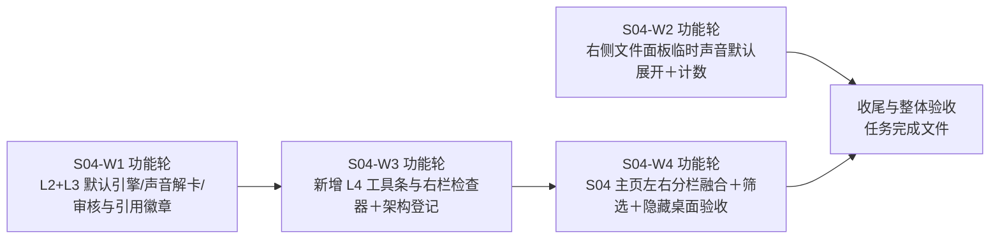

# 分镜预演工作台与管理预览审核改造任务书

> 编写日期：2026-11-27　｜　来源：用户 `/grill-me` 需求访谈拍板（会话 `47d374dc`，Q1–Q8 全量共识）＋公开参考《分镜预演工作流解析》差距盘点
> 基线提交：`master` `a3c102e62`（`R4590`，已含 `R4588` 方案 B：S04 只读优先复用 S05 正式资产图与 SG-B 提醒化）
> 复用要求（`程序/AGENTS.md` §2.5 规则 35、`程序/runbook.md` §16）：全面复用现有 `domain/animatic_*`、`orchestrator/stage_animatic_gateways.py`、`ui/animatic_prefs_bar.py`、`ui/animatic_player.py`、`ui/asset_thumbs.py`、`ui/ui_widgets.py`、`infra/storage_maintenance.recycle_paths`，**零新增第三方依赖**（评估外部剪辑/预演框架均超出 Tkinter 单机轻量边界与六包白名单，不引入）。
> 关联规格：`程序/docs/stages/S04_分镜预演.md`（`REQ-S04-114`…`117`、`DES-S04-37`…`40`）、`程序/docs/records/对话需求追溯.md`。

---

## 0. 总目标

解决当前 `04 分镜预演` 页面「零顶部按钮、大量入口藏在右键与折叠面板、默认引擎 `comfy_local` 易卡、未配 TTS 卡死文字分镜卡、生成视频后顶部封面锁死无法逐镜看大图、缺单镜审核与筛选」六大体验痛点，补齐「镜头管理＋分镜预览＋审核管理」工作台闭环：

1. **开箱零配置出片＋临时配音解卡（`REQ-S04-114`）**：默认草图引擎改为 `text_card`（文字分镜卡·零成本）；新增 `animatic_use_tts` 开关允许纯画面静音出片；显式菜单区分导入整轨配音 vs 背景音乐并提供回收站移除入口。
2. **轻量单镜审核与批量重做（`REQ-S04-115`）**：`timeline.json` 每镜新增可选 `review_status`（`pending`/`approved`/`needs_revision`），支持按场次／状态筛选与一键重做全部「需修改」镜头；点「锁定」时有「需修改」镜头即状态栏拦截提示，不强迫逐镜手动点通过。
3. **同页左右分栏工作台＋页顶 5 入口工具条（`REQ-S04-116`）**：页顶 1 行紧凑工具条（≤5 入口）；上半区宽屏左右分栏（左：空态 3 步引导／整片动态预览；右：当前选中镜头大图预览＋元信息＋带来源徽章的命中参考图＋直达入口＋单镜快捷操作与三态审核），窄屏 `<1200px` 自动上下堆叠；下半区时间线加筛选条与审核角标，保留全部右键与底栏发送键。
4. **右侧文件面板可见性优化（`REQ-S04-117`）**：保持 `镜头草图` 默认折叠守住 3000 镜性能红线并给分组标题加计数（如 `镜头草图 (12)`）；`临时声音` 改为默认展开（仍受 40 项预取上限保护）。

**明确不做（Q8 已拍板边界，严禁越界）**：
- 不在 S04 增加环境音／单镜动作音效轨（归剪映与 `11 配音与字幕`／`12 后期剪辑`）。
- 不在 S04 增加单镜 AI 图生视频测试 Video Test（复杂动作调度归 `09 白模预演`，正式视频归 `10 视频生成`）。
- 不导出剪映原生工程草稿（`.draft`），不支持在 S04 调整镜头顺序（顺序严格跟随 S03）。
- 零新增弹窗（`messagebox`／`ask_*`）；所有提示、错误与锁定拦截均写状态栏或页内条。

---

## 1. 已确认决策清单（Q1–Q8，执行者不得自行变更）

| 编号 | 决策 | 来源 |
|---|---|---|
| W-D1 | 目标定调：改造 S04 交互与可见入口，并补齐「镜头管理／分镜预览／审核管理」模块，保留现有底层引擎 | 用户 Q1 拍板＋参考链接要求 |
| W-D2 | 页顶加 **1 行紧凑工具条（固定 ≤5 项）**：生成/重合成、草图引擎下拉、声音 ▾、在剪映中打开、预演设置；保留全部右键菜单与底栏发送键 | 用户 Q2 拍板 |
| W-D3 | 未保存过偏好时的默认草图引擎由 `comfy_local` 改为 **`text_card`（文字分镜卡·零成本）**（显式修订 `REQ-S04-78`） | 用户 Q3 拍板 |
| W-D4 | 页顶 1 颗「声音 ▾」菜单钮：明确拆出导入整轨配音、导入背景音乐、移除整轨/音乐（进回收站）、逐镜临时 TTS 开关（关闭支持纯画面静音） | 用户 Q4 拍板 |
| W-D5 | **同页左右分栏融合（零切 Tab）**：左＝整片动态预览＋剪映；右＝选中镜头大图＋元信息＋命中参考图（带来源徽章）＋单镜快捷操作；下＝可按场次/状态筛选的分页时间线＋确认锁定条 | 用户 Q5 拍板 |
| W-D6 | **轻量闭环审核**：每镜可选 `review_status`（`pending`/`approved`/`needs_revision`）；支持筛选与重做全部「需修改」镜头；锁定时若有「需修改」镜头即拦截提醒，不强迫逐镜手动点通过，保留 3 项总确认 | 用户 Q6 拍板 |
| W-D7 | 右侧文件面板保持 `镜头草图` 默认折叠（组标题带计数，守住 3000 镜性能红线），`临时声音` 改为默认展开（显式修订 `REQ-S04-109`）；S04 右栏展示命中参考图来源徽章＋导入/打开目录直达 | 用户 Q7 拍板 |
| W-D8 | 不加环境音/动作音效轨，不加 S04 单镜 AI 视频测试，不导出剪映草稿，不调镜头顺序，零新增弹窗 | 用户 Q8 拍板 |

---

## 2. 现状盘点、1000 行棘轮红线与既有测试契约变更清单

### 2.1 受影响模块与行数红线（实测于 `master` `a3c102e62`）

| 文件 | 层级 | 实测行数 | 上限 | 余量 | 涉及任务卡 |
|---|---|---:|---:|---:|---|
| `程序/domain/animatic_sketch_backends.py` | L2 | 323 | 1000 | 677 | `S04-W1` |
| `程序/domain/animatic_audio.py` | L2 | 158 | 1000 | 842 | `S04-W1` |
| `程序/domain/animatic_timeline.py` | L2 | 161 | 1000 | 839 | `S04-W1` |
| `程序/domain/animatic_references.py` | L2 | 214 | 1000 | 786 | `S04-W1` |
| `程序/orchestrator/stage_animatic_gateways.py` | L3 | 822 | 1000 | 178 | `S04-W1` |
| `程序/stage_execution_service.py` | L3 | **980** | 1000 | **20 ⚠️** | `S04-W1`（合并至现有 import 行，净增 ≤3 行） |
| `程序/ui/desktop_files_panel_index.py` | L4 | 597 | 1000 | 403 | `S04-W2` |
| `程序/ui/animatic_toolbar.py`（新） | L4 | 0 | 1000 | 1000 | `S04-W3`（须登记 `_layers.py`＋覆盖率基线） |
| `程序/ui/animatic_inspector.py`（新） | L4 | 0 | 1000 | 1000 | `S04-W3`（须登记 `_layers.py`＋覆盖率基线） |
| `程序/ui/animatic_prefs_bar.py` | L4 | 212 | 1000 | 788 | `S04-W3` |
| `程序/ui/animatic_view_state.py` | L4 | 542 | 1000 | 458 | `S04-W4` |
| `程序/ui/animatic_page.py` | L4 | **944** | 1000 | **56 ⚠️** | `S04-W4`（禁止把工具条与检查器塞进本文件，改完保持 ≤950 行） |

### 2.2 因用户拍板有意变更的既有测试断言（须在对应轮结果文件按 `AGENTS.md` §2.4 逐条说明）

1. `程序/tests/test_animatic_sketch_backends.py` L98–109（`test_missing_settings_dispatch_to_comfy_local`）：因 Q3 将默认引擎改为 `text_card`，改为断言缺省与空设置落到 `text_card`，并保留显式 `comfy_local` 测试覆盖。
2. `程序/tests/test_files_panel_stages.py` L1843–1889（`test_animatic_panel_four_groups_collapse_and_prefetch_throttle`）：因 Q7 将 `临时声音` 改为默认展开并为分组标题追加计数，同步断言 `audio` 展开、`shots` 仍折叠且不进预取、标题含 `(N)` 计数。
3. `程序/tests/test_ui_edges_pages.py` L100–132（`test_animatic_page_low_button_layout`）：因 Q2/Q5 将页顶 5 入口工具条与右栏单镜快捷条纳入 S04 常驻控件，更新按钮上限断言（验证页顶工具条 ≤5 项、未生成视频前仍无页底确认勾选框），不删除或弱化其他页面断言。

### 2.3 新增 L4 模块的架构登记清单（`S04-W3` 必做）

- `程序/tests/architecture/_layers.py`：在 L173 `_register(4, ...)` 追加 `"animatic_toolbar"`, `"animatic_inspector"`；在 `SAME_LAYER_ALLOWED`（约 L213–233）按实际导入边登记（如 `('animatic_page', 'animatic_toolbar')`、`('animatic_page', 'animatic_inspector')`、`('animatic_toolbar', 'ui_widgets')`、`('animatic_inspector', 'ui_widgets')`、`('animatic_inspector', 'asset_thumbs')`、`('animatic_inspector', 'animatic_view_state')` 等，禁止新增未登记同层边）。
- 严禁在任何 L4 模块手写 `tk.PhotoImage`（全部经 `asset_thumbs`）、裸 `tk/ttk.Button`（全部经 `ui_widgets`）或弹窗（`messagebox`）。
- 刷新行覆盖率基线：`PY -B scripts\coverage_report.py`（核对 `tests/architecture/test_coverage_baseline.py` 通过）。

---

## 3. 并行与串行编排



- **可并行执行（零文件重叠）**：`S04-W1` 与 `S04-W2` 完全独立，可双线并行。
- **串行依赖**：`S04-W1` → `S04-W3` → `S04-W4`；四卡全绿后输出 `程序/tasks_round/任务完成/分镜预演工作台与管理预览审核改造·任务完成.md`。

---

## 4. YAML 任务卡（新会话可直接按卡执行）

### 4.1 卡 `S04-W1`：L2+L3 开箱默认引擎、临时配音解卡、单镜审核与命中参考图徽章

```yaml
任务卡: S04-W1
名称: S04 默认 text_card 引擎、静音容错、音频回收、单镜审核与参考图来源徽章
类型: 功能轮（AGENTS.md §3.1）
对应需求: REQ-S04-114、REQ-S04-115
对应设计: DES-S04-37、DES-S04-38
车道: codex/s04-workbench-core
前置: 无（可与 S04-W2 并行）
允许修改文件:
  - 程序/domain/animatic_sketch_backends.py
  - 程序/domain/animatic_audio.py
  - 程序/domain/animatic_timeline.py
  - 程序/domain/animatic_references.py
  - 程序/orchestrator/stage_animatic_gateways.py
  - 程序/stage_execution_service.py（严守 ≤1000 行，仅在既有 import 行合并导出）
  - 程序/tests/test_animatic_sketch_backends.py
  - 程序/tests/test_animatic_audio.py
  - 程序/tests/test_animatic_timeline.py
  - 程序/tests/test_animatic_references.py
  - 程序/tests/test_animatic_service.py
  - 程序/docs/stages/S04_分镜预演.md（翻绿 REQ-S04-114/115、DES-S04-37/38 并回填测试锚定）
  - 程序/tasks_round/tasks_round_<N>_result.md
行数与分层红线:
  - 四个 L2 模块（domain/animatic_*）严禁新增任何 L2 同层 import（守住 LR-03）。
  - stage_execution_service.py 现 980/1000，本卡净增 ≤3 行。
接口契约:
  - domain/animatic_sketch_backends.py:
    - DEFAULT_BACKEND = 'text_card'（原为 'comfy_local'）。
    - create(settings=None) 缺省或空 animatic_sketch_backend 时走 'text_card'；显式传 'comfy_local'／'gflow_cli' 行为不变。
  - domain/animatic_audio.py:
    - plan(shots, *, full_track=None, music=None, use_tts=True) -> dict：当 full_track 为空且 use_tts is False 时返回 {'mode': 'silent', 'full_track': None, 'music': bgm, 'tts_shots': []}，不触发逐镜 TTS。
  - domain/animatic_timeline.py:
    - REVIEW_STATES = ('pending', 'approved', 'needs_revision')；_CARRIED 追加 'review_status'；_new_row 默认 'review_status': 'pending'。
    - review_status_of(row) -> str：缺失或非法值归一为 'pending'（兼容旧 timeline.json）。
    - set_review_status(timeline, shot_id, status) -> dict：非 REVIEW_STATES 抛 ValueError，返回新副本。
    - needs_revision_ids(timeline) -> tuple[str, ...]：按镜头顺序返回所有 review_status=='needs_revision' 的 shot_id。
    - filter_shots(timeline, board, *, scene='', status='') -> list[dict]：
      - scene 非空时按分镜 shot 的 scene_id / scene / location 匹配（与 board 镜头字典对齐）；
      - status 支持 ''/'all'、'needs_revision'、'overlong'（按 dialogue_seconds > seconds + 0.1）、'missing_image'（image_version <= 0）。
  - domain/animatic_references.py:
    - shot_ref_badges(shot, lib, *, formal_assets=None) -> tuple[dict, ...]：
      - 与 refs_for_shot 严格同优先级同去重顺序，返回每项 {'path': Path, 'source': 'S05 资产'|'角色'|'场景'|'风格'|'未分类', 'label': str}（纯函数，零 L2 同层 import）。
  - orchestrator/stage_animatic_gateways.py & stage_execution_service.py:
    - _timeline_audio 读取 use_tts = bool(settings.get('animatic_use_tts', True)) 传入 animatic_audio.plan；若 use_tts=True 且 synthesize 失败，抛出可读中文错误提示可在「声音」关闭逐镜 TTS 先静音出片或配置语音。
    - remove_animatic_audio(project, track) -> tuple[Path, ...]：track 仅允许 'track' | 'music'，将该子目录下真实音频经 storage_maintenance.recycle_paths 移入回收站并返回移除路径。
    - update_animatic_shot(project, shot_id, *, seconds=None, image_version=None, note=None, review_status=None)。
    - regenerate_revision_shots(project, *, settings=None) -> dict：仅重做 needs_revision_ids(timeline) 中的镜头，每镜重做成功后重置 review_status='pending'；若无待改镜头抛 ValueError('当前没有标记「需修改」的镜头')。
    - shot_ref_details(project, shot) -> tuple[dict, ...]：组装 animatic_reference_library + _formal_animatic_assets 调用 shot_ref_badges。
    - lock_animatic(project, ...): 校验三项确认后、回写 S03 前检查 needs_revision_ids(timeline)，非空时抛 ValueError('还有 %d 个镜头标记为「需修改」（%s），请处理后再锁定' % (...))（≤45 字，遵守 copy_rules）。
测试（先红后绿，docstring 标注 REQ-S04-114 / REQ-S04-115）:
  - T1 (REQ-S04-114): DEFAULT_BACKEND == 'text_card'；animatic_audio.plan(..., use_tts=False) 在有对白时返 silent 且 tts_shots==[]；remove_animatic_audio('track'/'music') 走回收站且可恢复，非法 track 抛 ValueError。
  - T2 (REQ-S04-115): set_review_status 校验枚举与重建保留；旧 timeline.json 缺 review_status 兼容读为 'pending'；filter_shots 覆盖 scene、needs_revision、overlong、missing_image；regenerate_revision_shots 只重做需改镜并重置状态；lock_animatic 在有 needs_revision 镜时拦截且不改 S03、清除后正常锁定。
  - T3 (REQ-S04-115/113): shot_ref_badges 与 refs_for_shot 路径顺序完全一致，准确标注 'S05 资产'／'角色'／'场景'／'风格'／'未分类'。
  - T4: 同步 test_animatic_sketch_backends.py L98–109 并在结果文件按 AGENTS §2.4 注明契约变更。
验收命令（cwd=程序，PY=D:\漫剧制作助手\运行环境\Python\python.exe）:
  - PY -B -m unittest tests.test_animatic_sketch_backends tests.test_animatic_audio tests.test_animatic_timeline tests.test_animatic_references tests.test_animatic_service tests.test_copy_rules tests.architecture.test_layer_relations tests.architecture.test_module_size_ratchet tests.architecture.test_requirement_traceability -v
  - PY -B smoke_test.py
  - PY -B smoke_test.py --affected animatic_timeline
提交: PY -B scripts\dev.py commit -m "R<N>: S04 默认文字分镜卡、静音容错与单镜审核闭环 (REQ-S04-114, REQ-S04-115)" <文件…> --tests animatic_sketch_backends animatic_audio animatic_timeline animatic_references animatic_service copy_rules
```

---

### 4.2 卡 `S04-W2`：右侧项目文件面板「临时声音」默认展开＋分组计数

```yaml
任务卡: S04-W2
名称: S04 文件面板「临时声音」默认展开与分组标题文件计数
类型: 功能轮（AGENTS.md §3.1）
对应需求: REQ-S04-117
对应设计: DES-S04-40
车道: codex/s04-workbench-files-panel
前置: 无（可与 S04-W1 并行）
允许修改文件:
  - 程序/ui/desktop_files_panel_index.py
  - 程序/tests/test_files_panel_stages.py
  - 程序/docs/stages/S04_分镜预演.md（翻绿 REQ-S04-117、DES-S04-40 并回填测试锚定）
  - 程序/tasks_round/tasks_round_<N>_result.md
要求:
  - R1: ui/desktop_files_panel_index.py 的 ANIMATIC_GROUP_SPECS 中将 ('audio', '临时声音', False) 改为 ('audio', '临时声音', True)；('shots', '镜头草图', False) 严格保持默认折叠（守住 3000 镜性能红线）。
  - R2: animatic_grouped_rows(rows) 输出的分组展示名带数量，格式为 '%s (%d)' % (label, len(buckets[key]))（中文与数字／括号间隔守住 test_copy_rules）。
  - R3: 媒体缩略图预取上限 _MEDIA_PREFETCH_CAP = 40 与排除 .work/ 逻辑保持不变。
  - R4: 同步 tests/test_files_panel_stages.py L1843–1889 并在结果文件按 AGENTS §2.4 说明契约变更（REQ-S04-117 修订 REQ-S04-109）。
测试（先红后绿，docstring 标注 REQ-S04-117）:
  - T1: S04 面板 4 组中「参考图库」「预演版本」「临时声音」默认展开，「镜头草图」默认折叠且不进预取；4 组标题均带真实文件计数 (N)；3000 镜规模下预取仍严格 ≤40。
验收命令:
  - PY -B scripts\gui_hidden.py logs\s04_w2_panel.log . -- PY -B -m unittest tests.test_files_panel_stages -v
  - PY -B -m unittest tests.test_copy_rules tests.architecture.test_requirement_traceability tests.architecture.test_module_size_ratchet -v
  - PY -B smoke_test.py
提交: PY -B scripts\dev.py commit -m "R<N>: S04 文件面板临时声音默认展开并展示分组计数 (REQ-S04-117)" <文件…> --tests files_panel_stages copy_rules
```

---

### 4.3 卡 `S04-W3`：拆分新建 L4 页顶工具条与右栏镜头管理预览模块

```yaml
任务卡: S04-W3
名称: 新建 S04 页顶工具条与右栏镜头检查器模块并完成架构登记
类型: 功能轮（AGENTS.md §3.1）
对应需求: REQ-S04-116（L4 组件层）
对应设计: DES-S04-39（新模块拆分与架构登记）
车道: codex/s04-workbench-ui（接在 S04-W1 之后）
前置: S04-W1 已提交
允许修改文件:
  - 程序/ui/animatic_toolbar.py（新建，≤260 行）
  - 程序/ui/animatic_inspector.py（新建，≤380 行）
  - 程序/ui/animatic_prefs_bar.py（默认草图引擎回退改为 'text_card'，可选同步显示逐镜 TTS 开关）
  - 程序/tests/architecture/_layers.py（L4 模块注册＋SAME_LAYER_ALLOWED 边）
  - 程序/维护记录/覆盖率基线.json（经 scripts/coverage_report.py 刷新）
  - 程序/tests/test_animatic_page.py（新增工具条与检查器专项单测）
  - 程序/tasks_round/tasks_round_<N>_result.md
分层与控件红线:
  - 严禁使用裸 tk.Button / ttk.Button（统一用 ui_widgets.PrimaryButton / SecondaryButton / SelectBox / ContextMenu）。
  - 严禁手写 tk.PhotoImage（缩略图与大图预览统一经 ui.asset_thumbs.thumbnail）。
  - 严禁新增任何弹窗（messagebox / ask_*）。
  - 严禁从 L4 直接导入 domain/* 写盘或绕过 stage_execution_service。
接口契约:
  - ui/animatic_toolbar.py:
    - build_toolbar(parent, page, state, *, on_generate, on_engine_change, on_audio_action, on_open_jianying, on_toggle_prefs) -> dict：
      - 严格固定 5 个顶级交互控件：① 主按钮（有视频时文案「重新合成」，无视频时「生成分镜预演」）；② 草图引擎 SelectBox（SKETCH_ENGINE_OPTIONS，选中即调用 on_engine_change 落盘偏好）；③ 「声音 ▾」SecondaryButton（点击弹出 ContextMenu：导入整轨配音…、导入背景音乐…、分隔线、逐镜临时 TTS 开关、移除整轨配音、移除背景音乐）；④ 「在剪映中打开」SecondaryButton（始终可见）；⑤ 「预演设置」SecondaryButton。
      - 返回句柄字典供 refresh_toolbar(handles, page, state) 无重建刷新按钮文案与当前引擎。
  - ui/animatic_inspector.py:
    - build_inspector(parent, page, state, callbacks) -> dict & render_inspector(handles, page, state, row, shot_meta, ref_badges)：
      - 显示当前镜头的大图预览（经 asset_thumbs.thumbnail，无图时清晰占位提示）、版本 SelectBox（v1/v2…）、元信息行（场次／镜号／景别／运镜／时长／角色场景）、命中参考图列表（带来源标签 [S05 资产]／[角色]／[场景]／[风格]／[未分类]）＋「导入参考图…」「打开草图目录」快捷钮、单镜快捷操作（改时长／重做／换图／试听对白／批注）及「待审／通过／需修改」三态审核按钮。
      - 全部文案通过 tests/test_copy_rules.py（中英数字空格、无「文件夹」、不用「你」）。
测试（先红后绿，docstring 标注 REQ-S04-116）:
  - T1: build_toolbar 顶级控件数 ≤5；切草图引擎立即写入 animatic_sketch_backend；「声音 ▾」菜单含全部 5 项且导入整轨/音乐分别显式传 track='track'/'music'；「在剪映中打开」在无视频时可见且点击仅写状态栏提示。
  - T2: render_inspector 在有视频后切换镜头时实时刷新大图、元信息、命中参考图来源徽章与三态审核按钮；点三态审核触发回调。
  - T3: architecture 套件（test_layer_relations、test_button_boundary、test_ui_icons_boundary、test_dialog_boundary、test_module_size_ratchet、test_coverage_baseline）全绿。
验收命令:
  - PY -B scripts\coverage_report.py
  - PY -B scripts\gui_hidden.py logs\s04_w3_ui.log . -- PY -B -m unittest tests.test_animatic_page -v
  - PY -B -m unittest tests.test_copy_rules tests.architecture.test_layer_relations tests.architecture.test_button_boundary tests.architecture.test_ui_icons_boundary tests.architecture.test_dialog_boundary tests.architecture.test_module_size_ratchet tests.architecture.test_coverage_baseline -v
  - PY -B smoke_test.py
提交: PY -B scripts\dev.py commit -m "R<N>: 新增 S04 页顶工具条与右栏镜头检查器模块 (REQ-S04-116)" <文件…> --tests animatic_page copy_rules layer_relations button_boundary ui_icons_boundary dialog_boundary module_size_ratchet coverage_baseline
```

---

### 4.4 卡 `S04-W4`：S04 主页面左右分栏融合、时间线筛选与任务书闭环

```yaml
任务卡: S04-W4
名称: S04 主页左右分栏融合、空态引导、时间线筛选与全链路验收
类型: 功能轮（AGENTS.md §3.1）
对应需求: REQ-S04-116（全量收口，完成后翻绿 ✅）
对应设计: DES-S04-39
车道: codex/s04-workbench-ui（接在 S04-W3 之后）
前置: S04-W1、S04-W2、S04-W3 均已提交
允许修改文件:
  - 程序/ui/animatic_page.py（严守 ≤950 行，绝不超过 1000 行）
  - 程序/ui/animatic_view_state.py
  - 程序/tests/test_animatic_page.py
  - 程序/tests/test_ui_edges_pages.py（按 AGENTS §2.4 同步 test_animatic_page_low_button_layout）
  - 程序/docs/stages/S04_分镜预演.md（翻绿 REQ-S04-116、DES-S04-39，同步更新「交互」章节与测试锚定）
  - 程序/docs/records/对话需求追溯.md
  - 程序/docs/records/会话接续记录.md
  - 程序/tasks_round/分镜预演工作台与管理预览审核改造任务书.md（勾选 §5）
  - 程序/tasks_round/任务完成/分镜预演工作台与管理预览审核改造·任务完成.md
  - 程序/tasks_round/tasks_round_<N>_result.md
要求:
  - R1: 接入 animatic_toolbar（页顶）与 animatic_inspector（上半区右栏）；宽屏（>=1200px）左右分栏、窄屏（<1200px，复用 animatic_viewport_compact）自动上下堆叠且受 150ms 防抖保护。
  - R2: 左栏无视频时显示清晰 3 步空态引导（① 选草图引擎 → ② 可选导入参考图/声音或自动复用 S05 资产 → ③ 点「生成分镜预演」）；有视频后点击时间线任意镜头或按 ←/→ 时，右栏实时切换该镜大图与元信息，不再被左栏视频封面锁死。
  - R3: 下半区时间线上方加紧凑筛选条（按场次下拉＋状态筛选「全部／需修改／对白超长／缺草图」＋「重做全部需修改」按钮）；镜头格增加审核状态角标；保持 20 镜/页分页渲染（3000 镜常驻控件有界）。
  - R4: 全部旧右键菜单（播放区＋镜头格 7 项＋参考图挂钩）与底栏发送键（空发送／重做 SHxxx）继续正常工作；离开页面正确释放面板挂钩与防抖定时器。
  - R5: 在隐藏桌面中实测宽屏（1440×900）与紧凑屏（1100×760）几何不裁切，检查无越界与 1px 塌陷。
  - R6: 同步更新 S04_分镜预演.md 状态为 ✅、勾选本任务书 §5、输出同名任务完成文件并过 scripts/taskbook_closure.validate()。
测试（先红后绿，docstring 标注 REQ-S04-116）:
  - T1: 已有视频版本后点选 SH002，右栏大图与元信息实时切到 SH002（打破封面锁死）；左栏封面保持不变。
  - T2: 按场次／需修改／对白超长／缺草图筛选时间线结果正确；点「重做全部需修改」仅重做标记镜头；存在需修改镜头时点「锁定」拦截并写状态栏。
  - T3: 宽屏并排、窄屏堆叠两种几何下无控件裁切；3000 镜分页控件数有界；切页释放无残余回调。
验收命令:
  - PY -B scripts\gui_hidden.py logs\s04_w4_ui.log . -- PY -B -m unittest tests.test_animatic_page tests.test_ui_edges_pages tests.test_files_panel_stages -v
  - PY -B -m unittest tests.test_animatic_sketch_backends tests.test_animatic_audio tests.test_animatic_timeline tests.test_animatic_references tests.test_animatic_service tests.test_copy_rules -v
  - PY -B smoke_test.py
  - PY -B smoke_test.py --architecture
  - PY -B -c "import scripts.taskbook_closure as tc; assert tc.validate() == []"
提交: PY -B scripts\dev.py commit -m "R<N>: S04 主页左右分栏工作台融合与任务书收尾 (REQ-S04-116)" <文件…> --tests animatic_page ui_edges_pages files_panel_stages animatic_sketch_backends animatic_audio animatic_timeline animatic_references animatic_service copy_rules taskbook_closure requirement_traceability
```

---

## 5. 整体验收标准

四张卡全部完成后，须全部满足以下条件并输出 `程序/tasks_round/任务完成/分镜预演工作台与管理预览审核改造·任务完成.md`：

- [ ] **S04-W1 完成**：默认草图引擎改为 `text_card`、补齐 `animatic_use_tts` 静音容错与音频回收站移除、`timeline.json` 扩展单镜 `review_status` 与锁定拦截、`shot_ref_badges` 零新增 L2 同层边，`REQ-S04-114`／`REQ-S04-115` 翻绿为 ✅。
- [ ] **S04-W2 完成**：右侧项目文件面板「临时声音」默认展开、「镜头草图」保持默认折叠且分组标题带计数，3000 镜预取上限 ≤40，`REQ-S04-117` 翻绿为 ✅。
- [ ] **S04-W3 完成**：新建 `ui/animatic_toolbar.py` 与 `ui/animatic_inspector.py` 并完成 `_layers.py` 与覆盖率基线登记，严守零弹窗、控件边界与图标边界门禁。
- [ ] **S04-W4 完成**：`ui/animatic_page.py` 完成左右分栏／窄屏堆叠融合、空态 3 步引导、时间线场次与状态筛选及「重做全部需修改」，严守 ≤1000 行上限，`REQ-S04-116` 翻绿为 ✅。
- [ ] **整体验收与文档闭环**：默认冒烟、完整架构门禁（含 `test_taskbook_closure`、`test_requirement_traceability`、`test_layer_relations`、`test_module_size_ratchet`）、隐藏桌面宽／窄两档 UI 验收全部通过，`对话需求追溯.md` 与 `会话接续记录.md` 同步留痕。

---

## 6. 风险与回滚方案

| 风险 | 预防措施 | 回滚方案 |
|---|---|---|
| `ui/animatic_page.py`（944 行）或 `stage_execution_service.py`（980 行）突破 1000 行棘轮 | `S04-W3` 强制外拆工具条与检查器两枚 L4 新模块，`S04-W1` 仅行内合并导出，每卡验收均跑 `test_module_size_ratchet` | 单卡 `git revert` |
| 窄屏（<1200px）左右分栏造成控件挤压或裁切 | 复用 `animatic_viewport_compact` 自动切换上下堆叠并在 `S04-W4` 用隐藏桌面实测 `1440×900` 与 `1100×760` 几何 | 回退 `S04-W4` 提交 |
| 新增 L4 模块漏登记 `_layers.py` 或覆盖率基线导致架构门禁红 | 卡面已明确列齐登记点与 `scripts/coverage_report.py` 刷新命令 | 补登记或 `git revert <W3>` |
| 更改默认草图引擎为 `text_card` 影响依赖 `comfy_local` 的既有旧单测 | 已盘点锁定 `test_animatic_sketch_backends.py` L98–109，并在 `S04-W1` 显式同步与留痕；已保存过 `comfy_local` 偏好的真实用户不受影响 | `git revert <W1>` 恢复 `DEFAULT_BACKEND` |
| 「临时声音」默认展开触发大量媒体缩略图加载 | 沿用 `_MEDIA_PREFETCH_CAP = 40` 硬上限与排除 `.work/`，仅展开 `audio`、`shots` 仍默认折叠 | 仅改回 `ANIMATIC_GROUP_SPECS` 中 `audio` 布尔位为 `False` |
